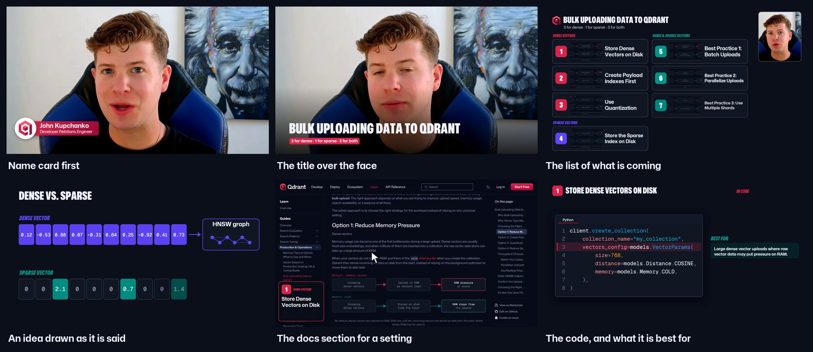
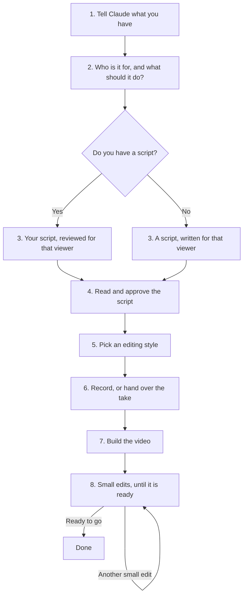
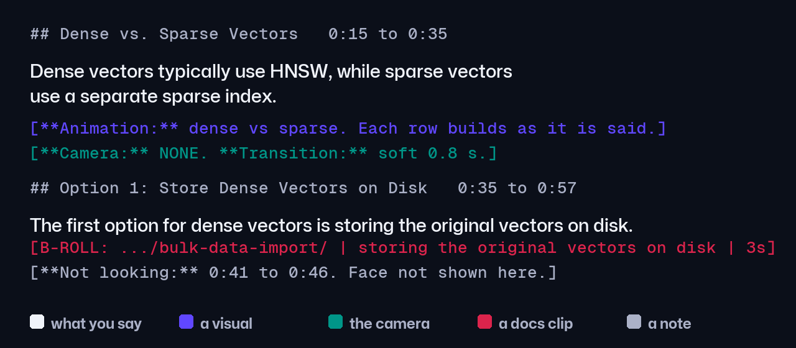
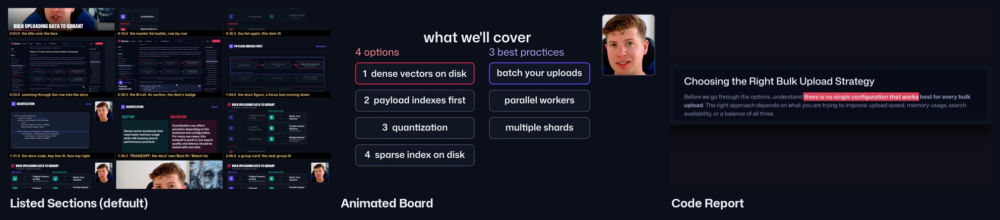
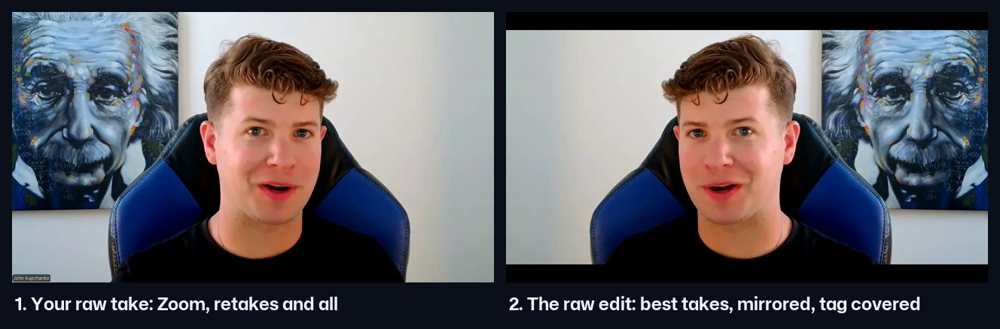
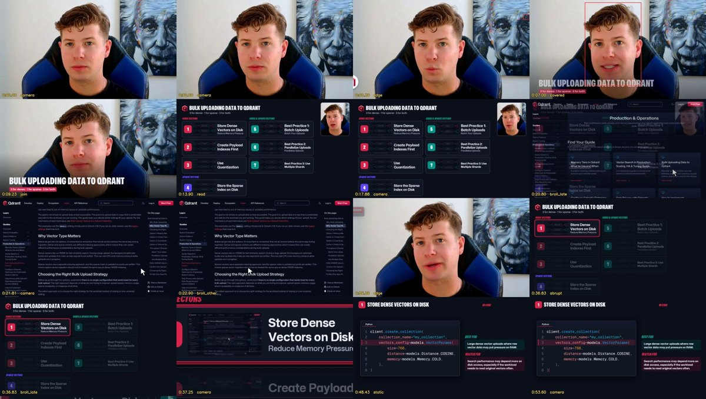

# Qdrant video suite

Skills that take a technical video from idea to edit with less hand work.
Write the script, plan the camera layout, record selected supporting scenes, then edit.
The script leads the full sequence; each available skill also works on its own.



*What it makes: one raw Zoom recording and one script in, this video out (Bulk Uploading Data to Qdrant, 3:17).*

## Start here

Everything in this suite runs from one thing: **the script**. You decide who the video is for, what it should do, how
long it is and how it looks. The skills decide the camera, the B-roll and the transitions from what they have learned,
and show their choices in the script, where you can change them.



**First time?** [Set it up](#set-up) once (about 15 minutes). Then open Claude Code and say **"I want to make a video"**:
the [start-here](skills/start-here/) skill walks you through these steps, one at a time, with a small map of where you are.

### 1. Tell Claude what you have

A video needs two things: **a script** and **a raw recording** of you reading it. The raw recording is the full,
unedited file straight from Zoom or your camera, retakes and all; the suite does the cutting. Nothing can be made
without a recording, so where you start depends on which of the two you have:

| you have | what happens |
|---|---|
| A script **and** the raw recording | The fastest path: the script is reviewed, you approve it, and the video is built. |
| A script, no recording yet | The script is reviewed and approved first, then you record it. Recording after the review means you read the final words. |
| An idea, notes or a docs page | The script is written with you, you approve it, then you record it. |

You are asked both: do you have a script, and do you have the raw, full recording?

> I want to make a video about bulk uploads in Qdrant. I have a script and the raw Zoom recording.

### 2. Who is it for, and what should it do?

You are always asked these, even with a finished script, because every later choice depends on them
([why each one matters](skills/technical-video-script-library/Audience%20and%20Purpose.md)):

1. What are you trying to do with this video?
2. Who is it for?
3. What do they already know?
4. What should they do after watching?
5. How long should it be?
6. What supports this? The docs page, an article, a blog post, a repo, a demo: the B-roll and the code on screen come
   from these, so nothing has to be searched for later. With none, some are found and proposed.
7. Your name and title, for the name card.

With nothing written yet, you also explain what you want to teach, in your own words. Then one of the
[ten story structures](skills/technical-video-script-library/) is recommended, with the reason.

### 3. The script, for that viewer

- **You have a script:** it is reviewed against your answers. Right viewer (terms explained, nothing over-explained),
  right goal, right length, an ending that pays off the hook, each section matched to the source that backs it, code
  and claims checked against today's docs.
- **You are starting from scratch:** it is written in the recommended structure for your viewer, goal and length.

### 4. Read and approve the script

You see the whole script: your lines, plus the B-roll, the camera and the transitions the skills filled in
([B-roll](skills/broll-recorder/), [camera](skills/camera-layout/), [transitions](skills/transitions/)). Every visual
supports what you are saying at that moment: a setting you name gets its docs section, an idea you explain gets an
animation that draws it, and a click into the docs only where you say where to find something. Change anything you
want, then approve it. This is the last point where changes are cheap.



### 5. Pick an editing style

| style | what it looks like |
|---|---|
| [Listed Sections](styles/listed-sections/) (default) | the video as a numbered list, the current item lit, the docs page's own figures and code |
| [Animated Board](styles/animated-board/) | one board per section that builds as you speak, five looks |
| [Code Report](styles/code-report/) | fast and visual: the real docs with highlights, captions and title cards |

Each style's look (B-roll, the presenter's window, transitions, zoom, reading pace) is set in its **style sheet**
([`engine/style_list.json`](engine/style_list.json) for Listed Sections), not clip by clip.



### 6. Record, or hand over the take

Read the approved script. Retakes and stumbles are fine: the [editing](skills/editing/) skill keeps the last good take
of every line and checks that you are looking at the lens.



### 7. Build the video: the raw edit first, then the visuals

Nobody should wait an hour and a half to find out something is wrong, so the build ([video builder](skills/video-builder/))
goes in pieces, each shown to you before the next:

1. **The raw edit, on its own** (a few minutes a round): your recording cut to the script, the best take of every line,
   clean joins, a couple of small zoom-ins. No B-roll, cards or animations yet. Small fixes (a pause, a false start, a
   word clipped) until you approve it.
2. **A preview** of the first minute (about 15 minutes), built on that approved raw edit: the style, the name card, the
   first visuals. You approve the direction. Where you looked away from the lens is marked in the script; reading from
   it is fine, the edit covers it.
3. **The whole video** (about an hour and a half).


### 8. Small edits, until it is ready

The [review](skills/video-review/) watches the finished video frame by frame and lists each problem with its time and a
picture; you add your own notes. Then the fixes go in as **small edits**: each one re-renders only the seconds it
touches, in minutes, and you see just that moment, not the whole video again. Repeat until the list is empty, then one
last full check, and the question: **ready to go?**



If you do not like the video as a whole, that is not a small edit: go back to the script (step 4) or the style (step 5).

## Or jump to one part

Already know what you need? Each skill below also works on its own. New parts of the suite are marked Coming soon.

<table>
<tr>
<td width="33%" valign="top">
<h3><a href="skills/technical-video-script-library/">Script writing</a></h3>
<p>Choose the viewer, hook, story structure and clean script layout.</p>
<p><strong>Available guide</strong></p>
</td>
<td width="33%" valign="top">
<h3><a href="skills/broll-recorder/">B roll</a></h3>
<p>Capture selected supporting scenes where they help explain the subject.</p>
<p><strong>Available skill</strong></p>
</td>
<td width="33%" valign="top">
<h3><a href="skills/brand-consistency/">Qdrant brand consistency</a></h3>
<p>The presenter's name card on every video, the brand's logos, colors and fonts, and the questions to ask before a build.</p>
<p><strong>Available skill</strong></p>
</td>
</tr>
<tr>
<td width="33%" valign="top">
<h3><a href="skills/editing/">Editing</a></h3>
<p>Hand over the raw take and the script; get back the clean cut, the good take of every line, eyes on the lens, with a cut list of every decision.</p>
<p><strong>Available skill</strong></p>
</td>
<td width="33%" valign="top">
<h3><a href="skills/transitions/">Transitions</a></h3>
<p>How the picture gets from one shot to the next: soft 0.8 s changes into and out of cards, a flash at a chapter.</p>
<p><strong>Available skill</strong></p>
</td>
<td width="33%" valign="top">
<h3><a href="skills/camera-layout/">Camera layout</a></h3>
<p>Plan face appearances, presenter size and consistent screen placement.</p>
<p><strong>Available skill</strong></p>
</td>
</tr>
<tr>
<td width="33%" valign="top">
<h3>Visual explanations</h3>
<p>Use diagrams, highlights and animation where the explanation needs them.</p>
<p><strong>Coming soon</strong></p>
</td>
<td width="33%" valign="top">
<h3>Audio and captions</h3>
<p>Keep speech clear, music restrained and captions readable.</p>
<p><strong>Coming soon</strong></p>
</td>
<td width="33%" valign="top">
<h3><a href="skills/video-review/">Final review</a></h3>
<p>Watch the finished video frame by frame and report every problem with its time and frame: the face, the text, the B-roll, the script, the sound.</p>
<p><strong>Available skill</strong></p>
</td>
</tr>
<tr>
<td width="33%" valign="top">
<h3><a href="skills/video-builder/">Build the whole video</a></h3>
<p>One request: the raw take and the script in, every skill in order, the finished video out with its review.</p>
<p><strong>Available skill</strong></p>
</td>
<td width="33%" valign="top">
<h3><a href="styles/">Editing styles</a></h3>
<p>Finished looks for the cut: Animated Board, Code Report, and Listed Sections, which builds itself from the script and the docs.</p>
<p><strong>Available</strong></p>
</td>
<td width="33%" valign="top">
</td>
</tr>
</table>

## 1. Script writing: [technical-video-script-library](skills/technical-video-script-library/)

Ten storytelling structures (the journey, the lesson, the practical tip, the comparison, and so on), a guide
for picking the viewer and the structure, and worked examples. Only selected supporting scenes need B roll.
Hand-off convention: the script marks each selected capture inline as
`[B-ROLL: URL | the line said there]` (syntax in `skills/broll-recorder/references/script-markers.md`). The
script skill is still being worked on; adding that marker to its output is the next step.

Defaults it helps with (each a small section inside the skill):

- choosing the viewer, their experience and funnel stage before the structure
- picking one of the ten structures from the viewer's question
- presentation and editing layout: where the hook, the proof and the follow-up go
- where B-roll belongs, and how to mark it

This folder is a subtree of the standalone repo `jkupchanko/technical-video-script-library`. Pull its latest
pushes in with:

```bash
git subtree pull --prefix skills/technical-video-script-library https://github.com/jkupchanko/technical-video-script-library.git main --squash
```

and push edits made here back out with `git subtree push` to the same prefix and remote.

## 2. Camera layout: [camera-layout](skills/camera-layout/)

The script determines what the viewer needs to see.
This skill plans presenter framing, inset size, content only views and split screen choices at the relevant passages.
It includes rectangular placeholder examples, a five minute camera plan and a review of thirty videos through ninety saved frame samples.
The full screen appearance count comes from the chosen sequence, rather than a fixed quota.
A measured audit of 32 popular AI and software-development videos (sampled every two seconds, 16 transcribed) backs the checks: opening hold, how fast the face returns, changes per minute, three layouts per video.
Hand-off from the script: a `[**Camera:** LAYOUT, position, size.]` line under the passage where the camera changes, required at the opening, wherever something must be read, wherever the person carries the line, at a section boundary, and at the close (`skills/camera-layout/references/camera-markers.md`).

## 3. B-roll: [broll-recorder](skills/broll-recorder/)

Trigger word: **B-roll**. Say what to show and get a finished 1080p60 clip in one consistent look: docs
zooms, article slides, code typing itself, title cards, and click-through flows done by the tool in a real
browser. Reads the `[B-ROLL: ...]` markers from step 1 and records them all in one run. Nothing to install
beyond a one-time `setup.py`.

Demo: `demos/broll_skill_pitch.mp4` (77 s).

## 4. Transitions: [transitions](skills/transitions/)

How the picture gets from one shot to the next, measured from the same 50 videos: 62% of visible changes
are labels and cards over a held shot, and among real shot changes 65% are cuts. Rules, taken only from what the
eight most-watched presenter-plus-screen videos do: cut by default, a 0.3 s push only for a card arriving
over the presenter, a white flash only at a chapter break. Qdrant's own house rule goes softer: about 0.8 s into and
out of every card (the quick changes read as abrupt), cuts only between takes of the face. Audits any video, renders
the same join several ways on real footage, and writes the choice into the script's Transition field.

## 5. Editing: [editing](skills/editing/)

The raw take and the script in, a clean cut out. Transcribes the recording, finds every take of every line
and keeps the last complete one, checks eye contact on each, cuts on word boundaries, mirrors, covers the
recording tag with matching bars, holds one small zoom-in for a stretch (never one at every cut), and writes a cut
list of every decision. `respan.py` makes a small fix to an approved cut (a pause, a false start, a clipped word)
without cutting again. The camera calls, B-roll and transitions are laid onto this cut.

## 6. The look: [editing styles](styles/)

The finished look laid onto the cut. Listed Sections builds itself from the script and the docs page, and its style
sheet sets its B-roll, presenter window, transitions and zoom.

## 7. Review: [video-review](skills/video-review/)

The last step, and the one that decides whether a video is ready. It watches the render, not the plan: the face on screen
while the eyes are off the lens, a stretched face or a head cut off by its window, lip sync, text cut at the edge or spilling
out of its card, tiny text, typos, numbers nobody gave, outdated API spellings, B-roll that is missing, late or on the wrong
section, lines the cut lost, a word clipped at a join, a missing or misspelled name card, empty or frozen frames,
loudness. Each finding comes with its frame. A self-test plants faults in a real clip and in a made-up take, and fails if
one is missed. When a person spots something the review missed, the review gets a check for it.

## 8. The whole video in one request: [video-builder](skills/video-builder/)

First it asks what only the presenter knows: the name and title for the name card, the take, the script, the docs page.
Then `build.py --take RAW.mp4 --script SCRIPT.md` runs every skill above in order and ends with the review. The script
controls the whole video: the lines, the B-roll, the camera calls, the transitions and the name card. Built from the raw
Bulk Uploads take, the first build's review found the six lines the cut had dropped and the B-roll lost with them; each fix
went into the skill that caused it, and the next build came back clean.

## 9. Brand consistency: [brand-consistency](skills/brand-consistency/)

Every Qdrant video shows the presenter's name early: a white circle with the Qdrant brandmark slides in from the bottom
left, a red bar unrolls with the name and title, it holds about 5 s and goes back. The script places it with
`[**Lower third:** NAME | TITLE | 5 s]`, and the review reads it off the screen.

## A finished example, every skill applied

`demos/bulk-uploads-first30/`: the first 30 seconds of the Bulk Uploads video from a raw Zoom take.
`face_only_720.mp4` is the edit on its own (takes chosen by transcript, eye contact checked, mirrored, bars,
push between cuts); `suite_720.mp4` adds the camera calls, the docs B-roll and the transitions. The script
with the calls, the cut list and the key-term B-roll pass sit beside them.

## Reviewing

This is open for review and use. Read the README in each skill folder, try the commands, and open an issue
or a pull request with what broke or what you would change. MIT licensed.

## Set up

Once per computer, about 15 minutes. You need Claude Code, Python 3.12+ and Google Chrome.

```bash
git clone https://github.com/jkupchanko/qdrant-video-suite.git
cd qdrant-video-suite
python setup.py
```

`setup.py` makes the Python environment, installs the packages, copies the skills into `~/.claude/skills`, points the
build at this repo's engine and fonts, checks the B-roll browser, and runs the self-test. It ends with **Ready**, or a
short TODO list of what to install. Run it again after every `git pull`. `python setup.py --check` changes nothing.

Then open Claude Code and say **"I want to make a video"**.

## Using a skill on its own

Ask in plain words; the SKILL.md or README.md in each folder is what Claude follows.
