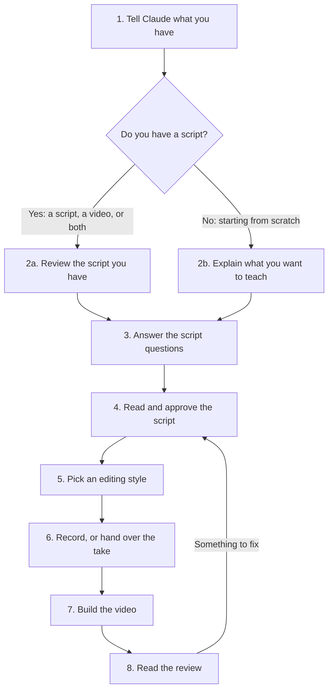

# Qdrant video suite

Skills that take a technical video from idea to edit with less hand work.
Write the script, plan the camera layout, record selected supporting scenes, then edit.
The script leads the full sequence; each available skill also works on its own.

## Start here

Everything in this suite runs from one thing: **the script**. The script says who the video is for, what it teaches, what
shows on screen and when, where the B-roll goes, how the camera moves and how each shot changes to the next. Every skill
reads the script and does its part. To change the video, you change the script.

So the path below is mostly about getting the script right. Once it is right, the rest follows from what the skills have
already learned.



### 1. Tell Claude what you have

Start a session with the skills installed (see [Using a skill with Claude](#using-a-skill-with-claude)) and say what you
are working with. For example:

> I want to make a video about bulk uploads in Qdrant. I have a script and a raw Zoom recording.

> I want to make a video about hybrid search. I have nothing yet, just the docs page.

There are two ways in, and both end at the same script.

### 2a. You already have a script (or a video)

Hand it over. Claude reads it and checks it before anything is built:

- **Who is it for, and what should they get from it?** If the script does not make that clear, you will be asked.
- **Is it in the suite's form?** Each passage needs its lines, and where it helps, a B-roll marker, a camera call and a
  transition. Anything missing is filled in from the skills' rules and shown to you.
- **Does it need changes?** A line nobody can follow, a section that runs long, B-roll on a line that names nothing
  specific: you get the suggested change and the reason, and you decide.

If you only have a recording and no script, the recording is transcribed and the script is written from what you said.

### 2b. You are starting from scratch

Explain what you want to teach in your own words. A few sentences, a list of notes, a docs link or a rough recording all
work. Do not worry about structure yet; that comes from the questions next.

### 3. Answer the script questions

These are the questions that decide what the video becomes. Claude asks only the ones your material does not already
answer ([why each one matters](skills/technical-video-script-library/Audience%20and%20Purpose.md)):

1. **Who is watching?** A developer, a customer, someone new to Qdrant?
2. **What do they already know** about this subject?
3. **What is the goal?** Should they understand something, choose between options, or be able to do a task?
4. **How long** should the video be?
5. **Which docs page** is it about? The B-roll and the on-screen figures come from it.
6. **Your name and title** for the name card at the start.

From the answers, Claude picks one of the [ten story structures](skills/technical-video-script-library/) (the practical
tip, the guided process, the comparison and choice, and others) and says why.

### 4. Read and approve the script

You get the script in three layers, all in one place:

- **The lines** you will say.
- **The B-roll**: which lines get a recording of the docs page, and which section. Only lines that name something specific
  get one ([how it decides](skills/broll-recorder/)).
- **The camera calls and transitions**: when your face is full screen, in a small window, or off screen, and how each shot
  changes to the next ([camera](skills/camera-layout/), [transitions](skills/transitions/)).

You do not have to plan any of this yourself. The skills fill it in from what they have measured in popular technical
videos. Read it, change what you want, and approve it. This is the last point where changes are cheap.

### 5. Pick an editing style

How the finished video looks. Each one takes the same script and the same recording:

| style | what it looks like |
|---|---|
| [Listed Sections](styles/listed-sections/) (default) | the video as a numbered list, the current item lit, the docs page's own figures and code |
| [Animated Board](styles/animated-board/) | one board per section that builds as you speak, five looks |
| [Code Report](styles/code-report/) | fast and visual: the real docs with highlights, captions and title cards |

### 6. Record, or hand over the take

Record yourself reading the approved script. Retakes and stumbles are fine: the [editing](skills/editing/) skill keeps
the last good take of every line and checks that you are looking at the lens.

### 7. Build the video

One request builds the whole thing: the cut, the B-roll recordings, the camera, the transitions, the style, the name
card and the sound ([video builder](skills/video-builder/)).

> Build the video from this take and this script.

### 8. Read the review

Every build ends with a [review](skills/video-review/) that watches the finished video frame by frame and lists each
problem with its time and a picture. Most fixes go back into the script, and the build runs again from that point.

## Or jump to one part

Already know what you need? Each skill below also works on its own. New parts of the suite are marked Coming soon.

<table>
<tr>
<td width="33%" valign="top">
<h3><a href="skills/technical-video-script-library/">Script writing</a></h3>
<p>Choose the viewer, hook, story structure and clean script layout.</p>
<p><strong>Available guide</strong></p>
</td>
<td width="33%" valign="top">
<h3><a href="skills/broll-recorder/">B roll</a></h3>
<p>Capture selected supporting scenes where they help explain the subject.</p>
<p><strong>Available skill</strong></p>
</td>
<td width="33%" valign="top">
<h3><a href="skills/brand-consistency/">Qdrant brand consistency</a></h3>
<p>The presenter's name card on every video, the brand's logos, colors and fonts, and the questions to ask before a build.</p>
<p><strong>Available skill</strong></p>
</td>
</tr>
<tr>
<td width="33%" valign="top">
<h3><a href="skills/editing/">Editing</a></h3>
<p>Hand over the raw take and the script; get back the clean cut, the good take of every line, eyes on the lens, with a cut list of every decision.</p>
<p><strong>Available skill</strong></p>
</td>
<td width="33%" valign="top">
<h3><a href="skills/transitions/">Transitions</a></h3>
<p>How the picture gets from one shot to the next, measured from 50 watched videos: cut, one push, one flash.</p>
<p><strong>Available skill</strong></p>
</td>
<td width="33%" valign="top">
<h3><a href="skills/camera-layout/">Camera layout</a></h3>
<p>Plan face appearances, presenter size and consistent screen placement.</p>
<p><strong>Available skill</strong></p>
</td>
</tr>
<tr>
<td width="33%" valign="top">
<h3>Visual explanations</h3>
<p>Use diagrams, highlights and animation where the explanation needs them.</p>
<p><strong>Coming soon</strong></p>
</td>
<td width="33%" valign="top">
<h3>Audio and captions</h3>
<p>Keep speech clear, music restrained and captions readable.</p>
<p><strong>Coming soon</strong></p>
</td>
<td width="33%" valign="top">
<h3><a href="skills/video-review/">Final review</a></h3>
<p>Watch the finished video frame by frame and report every problem with its time and frame: the face, the text, the B-roll, the script, the sound.</p>
<p><strong>Available skill</strong></p>
</td>
</tr>
<tr>
<td width="33%" valign="top">
<h3><a href="skills/video-builder/">Build the whole video</a></h3>
<p>One request: the raw take and the script in, every skill in order, the finished video out with its review.</p>
<p><strong>Available skill</strong></p>
</td>
<td width="33%" valign="top">
<h3><a href="styles/">Editing styles</a></h3>
<p>Finished looks for the cut: Animated Board, Code Report, and Listed Sections, which builds itself from the script and the docs.</p>
<p><strong>Available</strong></p>
</td>
<td width="33%" valign="top">
</td>
</tr>
</table>

## 1. Script writing: [technical-video-script-library](skills/technical-video-script-library/)

Ten storytelling structures (the journey, the lesson, the practical tip, the comparison, and so on), a guide
for picking the viewer and the structure, and worked examples. Only selected supporting scenes need B roll.
Hand-off convention: the script marks each selected capture inline as
`[B-ROLL: URL | the line said there]` (syntax in `skills/broll-recorder/references/script-markers.md`). The
script skill is still being worked on; adding that marker to its output is the next step.

Defaults it helps with (each a small section inside the skill):

- choosing the viewer, their experience and funnel stage before the structure
- picking one of the ten structures from the viewer's question
- presentation and editing layout: where the hook, the proof and the follow-up go
- where B-roll belongs, and how to mark it

This folder is a subtree of the standalone repo `jkupchanko/technical-video-script-library`. Pull its latest
pushes in with:

```bash
git subtree pull --prefix skills/technical-video-script-library https://github.com/jkupchanko/technical-video-script-library.git main --squash
```

and push edits made here back out with `git subtree push` to the same prefix and remote.

## 2. Camera layout: [camera-layout](skills/camera-layout/)

The script determines what the viewer needs to see.
This skill plans presenter framing, inset size, content only views and split screen choices at the relevant passages.
It includes rectangular placeholder examples, a five minute camera plan and a review of thirty videos through ninety saved frame samples.
The full screen appearance count comes from the chosen sequence, rather than a fixed quota.
A measured audit of 32 popular AI and software-development videos (sampled every two seconds, 16 transcribed) backs the checks: opening hold, how fast the face returns, changes per minute, three layouts per video.
Hand-off from the script: a `[**Camera:** LAYOUT, position, size.]` line under the passage where the camera changes, required at the opening, wherever something must be read, wherever the person carries the line, at a section boundary, and at the close (`skills/camera-layout/references/camera-markers.md`).

## 3. B-roll: [broll-recorder](skills/broll-recorder/)

Trigger word: **B-roll**. Say what to show and get a finished 1080p60 clip in one consistent look: docs
zooms, article slides, code typing itself, title cards, and click-through flows done by the tool in a real
browser. Reads the `[B-ROLL: ...]` markers from step 1 and records them all in one run. Nothing to install
beyond a one-time `setup.py`.

Demo: `demos/broll_skill_pitch.mp4` (77 s).

## 4. Transitions: [transitions](skills/transitions/)

How the picture gets from one shot to the next, measured from the same 50 videos: 62% of visible changes
are labels and cards over a held shot, and among real shot changes 65% are cuts. Rules, taken only from what the
eight most-watched presenter-plus-screen videos do: cut by default, a 0.3 s push only for a card arriving
over the presenter, a white flash only at a chapter break; dissolves, black fades and punch-ins were not
seen there and are not used. Audits any video, renders the same join several ways on real footage, and
writes the choice into the script's Transition field.

## 5. Editing: [editing](skills/editing/)

The raw take and the script in, a clean cut out. Transcribes the recording, finds every take of every line
and keeps the last complete one, checks eye contact on each, cuts on word boundaries, mirrors, covers the
recording tag with matching bars, alternates a slight push between cuts, and writes a cut list of every
decision. The camera calls, B-roll and transitions are laid onto this cut.

## 6. Assemble

Drop the clips into the timeline. More skills for this step will be added here as they are ready.

## 7. Review: [video-review](skills/video-review/)

The last step, and the one that decides whether a video is ready. It watches the render, not the plan: the face on screen
while the eyes are off the lens, a stretched face or a head cut off by its window, lip sync, text cut at the edge or spilling
out of its card, tiny text, typos, numbers nobody gave, outdated API spellings, B-roll that is missing, late or on the wrong
section, lines the cut lost, a word clipped at a join, a missing or misspelled name card, empty or frozen frames,
loudness. Each finding comes with its frame. A self-test plants faults in a real clip and in a made-up take, and fails if
one is missed. When a person spots something the review missed, the review gets a check for it.

## 8. The whole video in one request: [video-builder](skills/video-builder/)

First it asks what only the presenter knows: the name and title for the name card, the take, the script, the docs page.
Then `build.py --take RAW.mp4 --script SCRIPT.md` runs every skill above in order and ends with the review. The script
controls the whole video: the lines, the B-roll, the camera calls, the transitions and the name card. Built from the raw
Bulk Uploads take, the first build's review found the six lines the cut had dropped and the B-roll lost with them; each fix
went into the skill that caused it, and the next build came back clean.

## 9. Brand consistency: [brand-consistency](skills/brand-consistency/)

Every Qdrant video shows the presenter's name early: a white circle with the Qdrant brandmark slides in from the bottom
left, a red bar unrolls with the name and title, it holds about 5 s and goes back. The script places it with
`[**Lower third:** NAME | TITLE | 5 s]`, and the review reads it off the screen.

## A finished example, every skill applied

`demos/bulk-uploads-first30/`: the first 30 seconds of the Bulk Uploads video from a raw Zoom take.
`face_only_720.mp4` is the edit on its own (takes chosen by transcript, eye contact checked, mirrored, bars,
push between cuts); `suite_720.mp4` adds the camera calls, the docs B-roll and the transitions. The script
with the calls, the cut list and the key-term B-roll pass sit beside them.

## Reviewing

This is open for review and use. Read the README in each skill folder, try the commands, and open an issue
or a pull request with what broke or what you would change. MIT licensed.

## Using a skill with Claude

Copy the skill folder into `~/.claude/skills/` (or point Claude Code at it) and ask in plain words. The
SKILL.md or README.md in each folder is what Claude follows.
