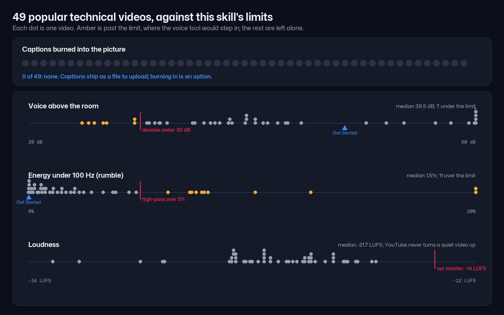

# Audio and captions

**Your cut in; an even, clean voice and captions spelled right out.**

A cut joins pieces recorded minutes apart, so one sentence can come in quieter than the last. Rooms hum, fans rumble,
and a transcript hears "Quadrant" when you said "Qdrant". This skill measures your take, fixes only what it finds, and
writes captions from what you said, spelled the way your script spells it.


## Your voice

- **One level.** Every piece of the cut is brought to the same level, with soft ramps so no join steps.
- **Only what your take needs.** Room noise, mains hum and low rumble are each measured first. Each is taken out only
  when it is worse than nearly every one of 49 popular technical videos. A clean take is left alone.
- **On your lips.** Nothing moves the voice in time: every filter's delay is measured and taken back.


## Your captions

- **What you said, spelled like the script.** "Quadrant" becomes "Qdrant" and "web ui" becomes "Web UI". A word you
  really said differently stays as you said it.
- **A file to upload.** `captions.srt` and `captions.vtt` go to YouTube as closed captions, which viewers can turn on
  and search can read. None of the 49 popular videos burns captions into the picture, so that is the default.
- **Burned in when you want it.** For a clip that plays without sound, `--burn-captions` adds a copy with the
  captions in the picture, in the brand font.


## Checked against 49 popular technical videos

Every limit was set from the same 49 videos the other skills were measured on. The reasons and the numbers are in
[references/research.md](references/research.md).



## Use it

It runs inside every build (`build.py`): the voice right after the cut, the captions after the master. Add
`--burn-captions` for the burned copy. To add a product name the captions keep getting wrong, put a line in
[references/glossary.txt](references/glossary.txt):

```
Qdrant <- quadrant, cudrant
```

Or just tell Claude: "the volume jumps at 1:20" or "the captions spell our product wrong".
