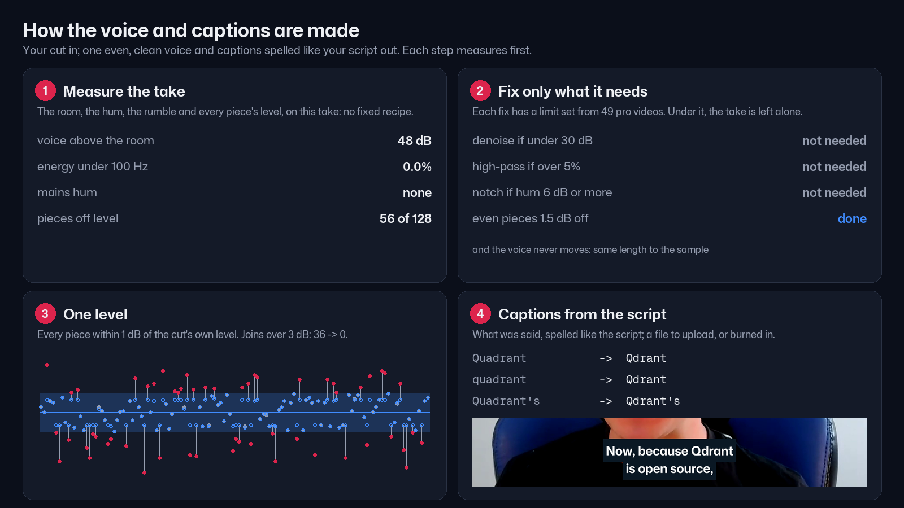
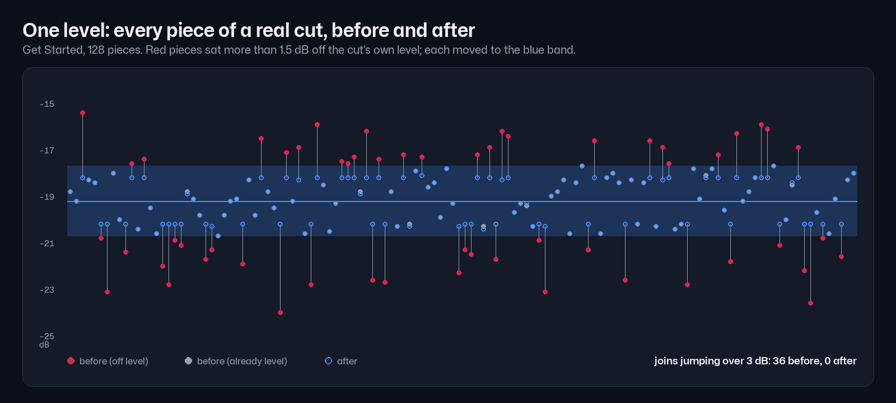
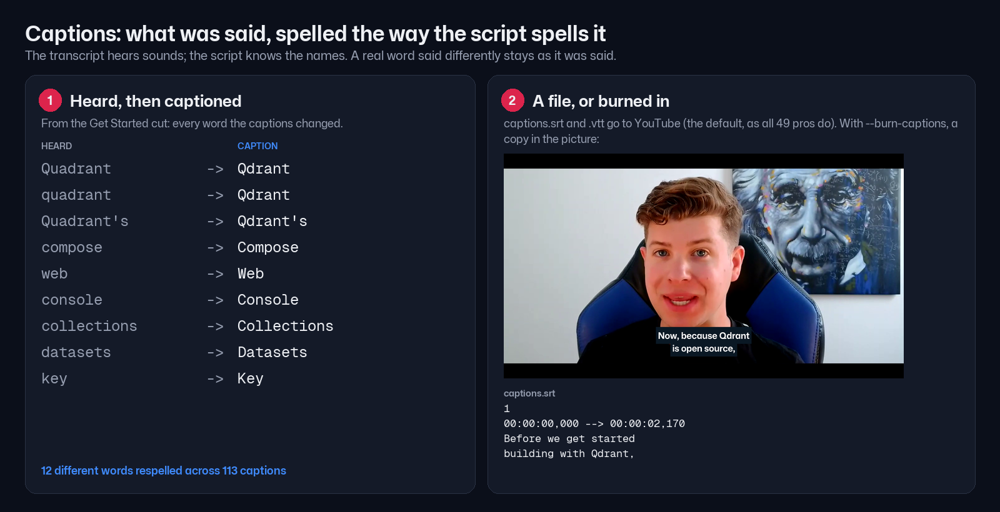

# Audio and captions

The voice should sound like one person in one room at one level, and the captions should read the way the script is
spelled. This skill does both, measuring the take first and fixing only what it finds.



## The rules (the reason for each, and the numbers: [references/research.md](references/research.md))

1. **One level.** Each piece of the cut (from the cut list) more than 1.5 dB from the cut's own median level is brought
   to within 1 dB of it, at most 6 dB, with 30 ms ramps.
2. **Only the fixes this take needs.** Denoise (ffmpeg anlmdn) only when the voice is under 30 dB above the room; an 80 Hz
   high-pass only when over 5% of the energy is under 100 Hz; a notch only for a mains hum 6 dB out of the quiet. A clean
   take is left alone.
3. **The voice stays on the lips.** Every filter's delay is measured and taken back; the length is kept to the sample.
4. **Captions are what was said, spelled as the script spells it.** A word heard close to the script's word takes the
   script's spelling ("quadrant" -> "Qdrant", "web ui" -> "Web UI"); a real word that differs was said, and stays. Then
   `references/glossary.txt` for names the script does not carry.
5. **A file by default, burned in on request.** None of the 49 pro videos burns captions in. SRT and VTT to upload;
   `--burn` for a copy in the picture (Mona Sans on a dark box, `references/caption_style.json`).
6. **Readable.** Two lines of up to 42 characters, 1 to 7 s, held long enough to read at 17 characters a second,
   broken at a full stop, then a comma or a pause.



## Run it

The video-builder runs it: the voice stage after the cut (`cut/cut_voice.mp4`, which the style stage then uses) and
the captions stage after the master (`captions/`). `build.py --burn-captions` adds the burned copy. By hand:

```bash
S=~/.claude/skills/audio-captions/scripts
python $S/voice_clean.py CUT/cut.mp4 --out CUT/cut_voice.mp4 --cutlist CUT/cutlist.md --report CUT/voice.json
python $S/captions.py VIDEO.mp4 --cutlist CUT/cutlist.md --words CUT/words.json --script SCRIPT.md --out CAPTIONS [--burn]
python $S/checks.py --srt CAPTIONS/captions.srt --voice CUT/voice.json     # exit 1 if anything is to fix
python $S/selftest.py                                                       # the tools still catch what they should
```

VIDEO is anything on the cut's timeline (the cut, the cleaned cut, the styled master). `words.json` is the take's
transcript in source time (the cut stage writes it).



## What the checks say

`checks.py` sorts what it finds into **fix** (must change before anyone sees it) and **check** (look or listen):

- fix: a product name misspelled (glossary), a line over 42 characters or more than two lines, overlapping cues, the
  cleaned voice a different length from the cut.
- check: a cue on screen under 0.8 s, a cue faster than 20 characters a second and 1.3 times this speaker's own pace
  (a fast talker's captions cannot be slower than the talk), a join still over 3 dB, a voice still under 30 dB above
  the room.

## When someone finds something the checks missed

A misspelled term: add it to `references/glossary.txt` (`Right <- wrong, wrong`). A new kind of fault: plant it in
`selftest.py`, make the tool catch and fix it there and on the real case, and see whether the 49 videos agree
(`scripts/audit_audio_captions.py`). Then fix the video.

## Files

- `scripts/voice_clean.py`: measure, clean, even; writes what it did and why.
- `scripts/captions.py`: SRT, VTT and the burned ASS from the cut's words and the script.
- `scripts/checks.py`: the checks above. `scripts/selftest.py`: planted faults, caught and fixed.
- `scripts/audit_audio_captions.py`: the 49-video research. `scripts/make_images.py`: this skill's pictures.
- `references/glossary.txt`, `references/caption_style.json`, `references/research.md`.
