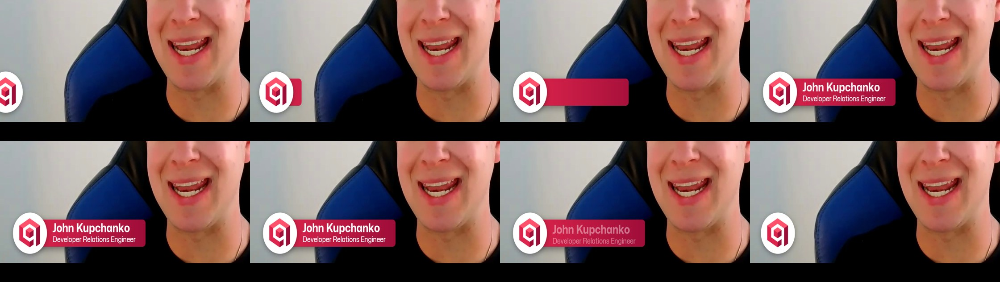

# Qdrant brand consistency

Qdrant videos look like each other on purpose. The presenter's name always comes up early, in the same card. The colours
and type are the brand's, and every logo is the supplied file. This skill holds those pieces for the suite: the name lower
third, the rules, and the questions to ask before anything is built.


## Before building: the questions only the presenter can answer

A build makes most of its choices on its own. It cannot know your name and title, and a guessed one shows on screen.
So the [video builder](../video-builder/) asks first:

1. Your **name**, as it should read on the name card?
2. Your **title** under it?
3. Where is the **raw take**?
4. Is there a **script** in the three-layer form, or should one be written (and shown) first?
5. Which **docs page** is it about?
6. Which **style**?

If the script has no name card and no `--name` / `--role` is given, the build stops, prints these questions and exits.
A question that the conversation or the script already answers is not asked again. The builder says what it is using.
See [references/intake.md](references/intake.md).

## The script runs it

The video is controlled by the script, and the name card is one more direction in it:

```
It's also handling indexing, payloads, and much more in the background.

[**Lower third:** John Kupchanko | Developer Relations Engineer | 5 s]
```

It comes in on the line above it and holds for the seconds given. The style moves it later if the eyes leave the lens
inside its window. It shortens the hold to fit before the next graphic, never under 3 s.

## The lower third



| part | value |
|---|---|
| circle | the supplied `Qdrant-Profile-Circular-Light` logo, cropped to its circle, white ring |
| bar | Qdrant Red `#DC244C` into Primary Dark `#9E0D38` (the gradient is on the bar only, never on text) |
| name, title | Mona Sans Bold and Regular, white |
| place | bottom left, above the bottom letterbox bar, clear of the face |
| motion | the circle slides in, the bar unrolls out of it, the words rise; it holds about 5 s, then goes back the same way |

```bash
python scripts/lower_third.py --name "John Kupchanko" --title "Developer Relations Engineer" --frame STILL.jpg --sheet sheet.png
python scripts/lower_third.py --name "..." --title "..." --frame STILL.jpg --mp4 lower_third.mp4
```

In code: `LowerThird(name, title, t_in, hold=5.0)` is a function of time that returns the card's layer for each frame,
laid over whatever shot is on screen.

## The review checks it

The [final review](../video-review/) reads the name card from the pixels. These are **fixes**:

- the script has no name card;
- the card never appears;
- it reads differently from the script's spelling;
- it has no title.

These are **checks**:

- it is held much shorter than the script asks;
- it is not in the lower left;
- it is up while the presenter is off screen;
- it comes in after the first minute.

## The rest of the brand on screen

- Background `#0B0F19`, cards `#111824`, text `#F0F3FA`, secondary `#656B7F`, border `#4E5366`, accent Qdrant Red.
- Mona Sans for headings and body, Geist Mono for code; never gradient text.
- The brand's code card: a surface card, a header bar with the language tab, and line numbers in `#656B7F`.
- The video ends on the supplied `Qdrant-Logo-Red-White`.

Fonts: Mona Sans (GitHub) and Geist Mono (Vercel), SIL Open Font License 1.1 ([assets/fonts/FONTS.md](assets/fonts/FONTS.md)).
