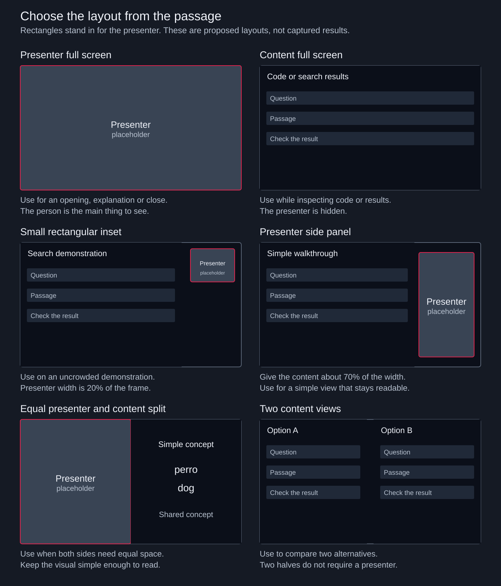
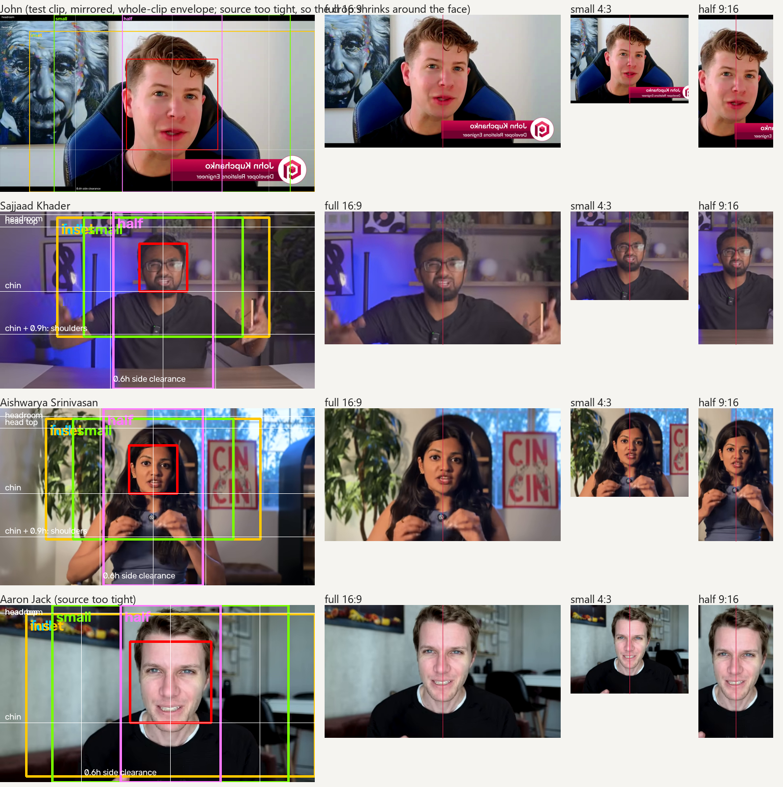

# Camera Layout

A skill for choosing presenter framing and screen space from a script or a standalone scene brief.
It plans where the face belongs, how large it is, when it disappears and what the next view should be.
Examples use rectangular placeholders, with no actual faces.

[Read the skill](SKILL.md)

## Six layout examples



The diagrams are proposed compositions.
They distinguish full screen content, a small inset, a content dominant side panel, equal halves and a comparison between two content views.

## What the measured audit found

32 of the most-watched AI and software-development videos (Fireship, NetworkChuck, Tech With Tim, IBM, Theo,
Sajjaad Khader and others) were sampled every two seconds, and 16 of them were transcribed so each camera
change could be tied to what was being said.

- Videos use three layouts, not one. A small window left in the corner for the whole video is the exception.
- The most common move is face to screen and back; nearly half of all changes are that pair.
- The face comes back fast: three videos in four return to the full face within 40 s, and stretches with no
  face run about 10 s and rarely pass 50 s.
- The opening holds about 20 s before the first change, on the face or on the screen.
- Changes happen where the sentence turns ("now", "so", "let's") and where the words name the screen
  ("code", "terminal", "run", "click"), not on a clock.
- Two families: cut videos (mostly face, 3-4 changes a minute) and window videos (one window over the
  screen, under 1 change a minute). The cut family is the more watched one in this sample.

Numbers: [tendencies.md](references/tendencies.md). Speech at each change: [cues.md](references/cues.md).
The five measured layout classes with proportions: [layouts.md](references/layouts.md).
These are observations of a sample, not a retention formula.

## Framing the face



Measure the face, keep headroom above the head, run down past the chin to the shoulders, keep clear space on
both sides for turns, centre the face. `scripts/frame_face.py` applies it to a still or a whole take and says
when the source was shot too tight to allow it.

## How it works with the suite

The script supplies the narration, section times and selected supporting inserts.
Camera layout attaches decisions to those passages while preserving the story.
The capture workflow records only the supporting scenes the script requests.
Transition directions state the intended connection between views; editing effects remain a separate choice.

## Try it on its own

Give the skill a scene or script, its format and what the viewer needs to inspect.
For example: explain a simple concept, then show a code call and its result, using rectangular presenter placeholders.
It can also plan a video with narration and no visible presenter.

For a first pass by script:

```bash
python scripts/camera_plan.py SCRIPT.md --out camera_plan.md
```

It reads the suite's script format (sections with times, Camera and Show directions, B roll blocks) or plain
prose, applies the checks above, and lists where it disagrees with the script's own Camera notes.
To measure a video instead of planning one:

```bash
python scripts/audit.py VIDEO.mp4 --sheet check.png
```

## Worked example and review

[See the audit of a finished Qdrant video](examples/bulk-uploads-audit.md) (Bulk Uploads: habits versus the corpus, framing, the small window on real footage)

[See the five minute camera plan](examples/miniCOIL-camera-plan.md) and
[the planner's generated plan for the same script](examples/miniCOIL-camera-plan-generated.md)

[See how a script carries camera calls, and when one is required](references/camera-markers.md)

[See the layout decisions and sizing](references/decision-guide.md)

[See the annotation and machine handoff format](references/output-format.md)

[Read the review of the earlier video sample](references/frame-review.md) (ninety saved stills) and
[the measured audit](references/tendencies.md) (32 videos, continuous)

The skill was also applied independently to the approved five minute script, a simple marketing comparison and a vertical scene without a presenter.
Checks covered script preservation, timeline coverage, rectangle geometry and protected content.
Inspect actual captures at the intended viewing size before recording or editing.

## Files

```
camera-layout/
  SKILL.md, README.md
  scripts/camera_plan.py     script -> camera plan with checks
  scripts/audit.py           video -> layout timeline and stats
  scripts/tendencies.py      many audits -> the habits
  scripts/cues.py            transcripts + audits -> what is said at each change
  scripts/frame_face.py      face -> crops by the framing rule, with a guide image
  scripts/window_overlay.py  screen clip + face take -> rectangular window by the rule
  references/                decision-guide, output-format, layouts, frame-review, tendencies, cues, audit_summary.csv
  examples/                  worked plan, generated plan, machine-handoff json
  assets/layout-examples.svg
```

Scripts need Python with opencv-python, numpy and imageio-ffmpeg; cues.py also needs faster-whisper.

[Return to the suite](../../README.md)
