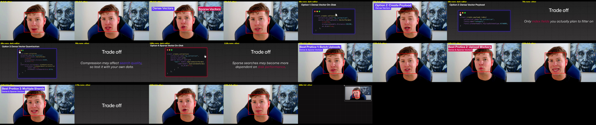
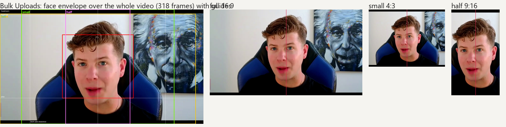
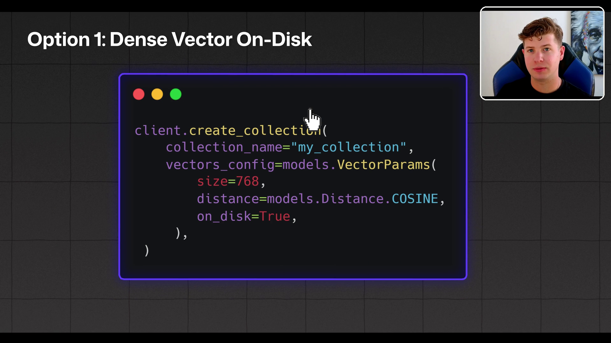

# Worked example: auditing a finished video (Bulk Uploads, 3:27)

The skill run on an existing Qdrant video, the same way as the 32-video corpus: `audit.py` sampled every
2 s, `frame_face.py` measured the face over the whole take (318 frames), and `window_overlay.py` rendered the
small window the video does not yet use.



## How the camera is used

| | Bulk Uploads | corpus, cut style |
|---|---|---|
| layouts used (5%+ of time) | 2: full, screen | 3 |
| face on screen | 47% | 36% |
| screen only | 53% | 31% |
| changes per minute | 6.9 | 2.4 median, 6.1 max |
| opening hold | 12 s | about 20 s |
| longest face run | 18 s | 50 to 70 s |
| longest no-face stretch | 16 s | 10 s median, rarely over 50 |
| opens / closes on | face / face | face / face |

Timeline: full 0-12, screen 12-18, full 18-36, then face and screen alternating in 4 to 16 s pieces to the
end; twelve of the 24 changes land on 4 s face shots.

Reading: already in the cut family (face to screen and back), face returns fast, opens and closes on the
person. Cuts more than anything in the corpus; the 4 s face beats between code cards are what reads as busy.
The habit would be to let some face runs reach 15 to 25 s and put the small window over the code card for the
short remarks instead of cutting back to full. No window layout is used; it is the missing third layout.

## Framing



The face is dead centre horizontally and the crops come out centred. The source is too tight for the rule: it
wants about 212 px more below the chin and 66 px above the head, so shoulders never enter the frame. That is a
camera note for the next shoot (step back or widen), not an edit note.

## The small window on the real footage



`bulk-uploads-small-window.mp4` is 12 s of it with the face live. Made with:

```bash
python scripts/window_overlay.py "Bulk Uploads_FinalCleanUps.mp4" "Bulk Uploads_FinalCleanUps.mp4" --screen-start 36 --face-start 18 --duration 12 --crop 203,0,1440,1080 --width 0.20 --corner top-right --out bulk-uploads-small-window.mp4
```

The window sits in the empty top-right area, clear of the title and the card. On this take it shows head and
a little neck; on a take shot to the rule it would show shoulders at the same size.
