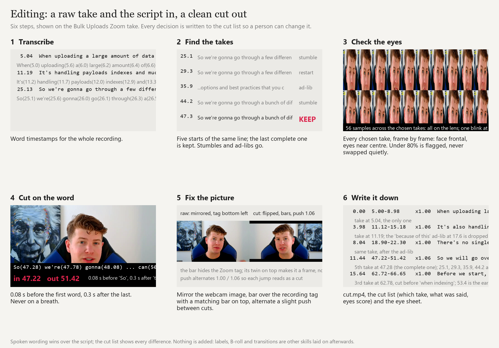

# Editing

**A raw talking-head take and the script in; a clean cut and a cut list out.**

The editing piece of the video suite. You record the way you record now, retakes and all, hand over the
recording and the script, and get back the first-pass cut a careful editor would make by hand: the good
take of every line, cut on the word, eyes on the lens, picture fixed, audio clean. Every decision is written
down so you can change any of them.



## What it does

1. Transcribes the recording with word timestamps.
2. Finds every take of every script line and keeps the last complete one; stumbles and ad-libs go.
3. Checks eye contact on every chosen take, frame by frame, and flags any take where the eyes wander.
4. Cuts on word boundaries, placed by the sound: in the pause before the first word and after the last, never into the
   next word, never mid-word, and never with the same words twice. (Transcript times alone are up to a quarter second off;
   they clipped a word a person heard.)
5. Mirrors the picture if the webcam recorded a mirror image, covers the recording tag with matching bars
   top and bottom, and alternates a slight push between cuts.
6. Fades the audio at every join and writes `cut.mp4`, `cutlist.md` and `gaze_sheet.png`.

## The rules

[references/rules.md](references/rules.md) has the 21 rules the cut follows: the last complete take wins,
retakes within 45 s compete and later lines do not, half-takes can be joined, spoken wording wins, eyes on
the lens or flagged, out-points follow the real end of speech so no line is clipped, pauses over 0.7 s are
removed, mirror, bars, push, fades, and read the cut list before shipping.

## Use it

```bash
python scripts/cut_takes.py RAW.mp4 SCRIPT.md --out DIR --max-seconds 30 --mirror --bars 72
```

Then read `cutlist.md`. It says which take each line came from, where the spoken words differ from the
script, and which takes need a human look.

## What it does not do

No labels, music, B-roll or transitions. Those come from the other skills and are laid onto this cut.
It also does not fix a take that was never said: it tells you.

## Files

```
editing/
  SKILL.md, README.md
  scripts/cut_takes.py     raw take + script -> cut, cut list, eye-contact sheet
  references/rules.md      the 21 rules the cut follows
  assets/how-it-works.png  the six steps on a real take
```

Needs Python with faster-whisper, opencv-python, numpy and imageio-ffmpeg.
