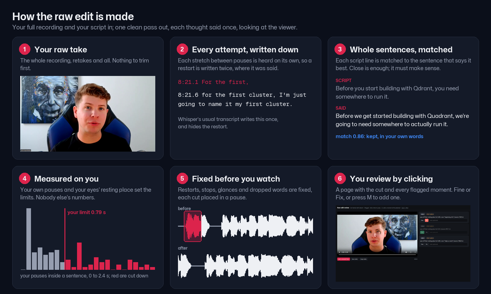
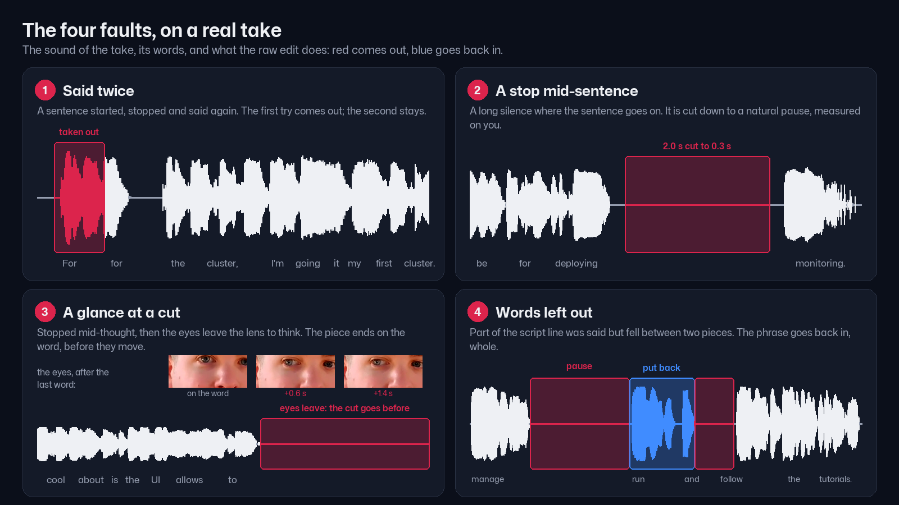
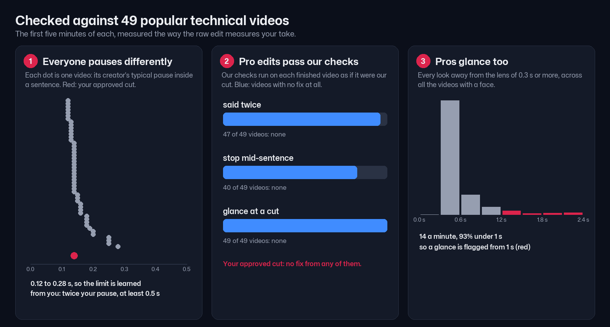
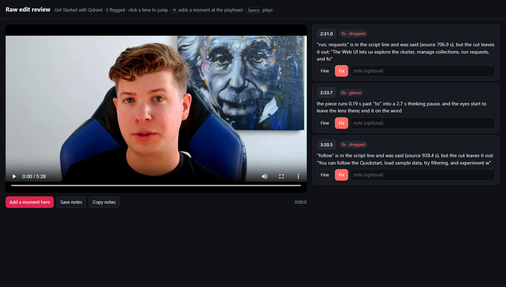

# Raw edit

The presenter's own footage, cut to the script, before anything visual is added. A viewer should hear one person say
each thought once, in whole sentences, looking at them. This skill makes that cut, checks it against the presenter's own
way of speaking, fixes what it finds, and hands the presenter a page to review on.



## The rules (why each one: [references/rules.md](references/rules.md))

1. **Each thought said once.** No restart left in. A list that repeats its opening on purpose ("you can run it locally,
   you can deploy it") is not a restart: the first try counts only if it was cut off or matches for three words.
2. **No stop inside a sentence.** No silence after a word that does not end the sentence longer than this presenter's own
   pause inside a sentence (at least 0.5 s), counting a piece's tail plus the next piece's head.
3. **No glance with words over it.** Above all, a stop mid-thought ("...allows you to") that runs into a thinking pause as
   the eyes leave: the piece ends on the word.
4. **Nothing lost from the middle of a line.** A word of the script line, said between two kept pieces of that line but
   not in the cut ("run requests").
5. **Whole sentences, close to the script, not word for word.** The spoken wording wins when it says the same thing.



## Measured on the presenter, never a constant

People pause, glance and restart differently, and a whole team uses this. Every limit is learned from the take first
(`scripts/raw_edit_checks.py`, `speaker()`): the pause inside a sentence from the sound (a literal transcript's word times
have no gaps), the quiet and voice levels from the take's loudness, the eyes' resting place and spread from the iris over
the whole take. What 49 audited videos say about each limit is in [references/research.md](references/research.md):



## Run it

The video-builder's cut stage runs all of it (`build.py --only cut`). By hand:

```bash
S=~/.claude/skills/raw-edit/scripts
python $S/transcribe_literal.py RAW.mp4 --out CUT/words_literal.json         # every attempt, where it was said
python ~/.claude/skills/editing/scripts/gaze.py RAW.mp4 --out CUT/raw_gaze.json
python $S/sentence_cut.py RAW.mp4 SCRIPT.md --words CUT/words.json --gaze CUT/raw_gaze.json --out CUT --mirror --bars 72
python $S/verify_pieces.py CUT RAW.mp4 --mirror --bars 72 --literal CUT/words_literal.json
python $S/fix_cut.py CUT RAW.mp4 --apply                                     # the check's own fixes
python $S/raw_edit_checks.py RAW.mp4 CUT/cutlist.md --literal CUT/words_literal.json --gaze CUT/raw_gaze.json
python $S/review_page.py CUT RAW.mp4                                         # CUT/review.html
```

`words.json` is the take's ordinary transcript (editing's `cut_takes.transcribe`; the build writes it).

## Heard in the cut, not read off the take's transcript

The take's transcript says where words were said; only the cut's own sound says what the viewer hears. Around a restart
the transcript's word times smear, so three things are checked by ear (`raw_edit_checks.hear_cut`, `said_twice`):

- **Words said twice across a join.** The end of each piece and the start of the next are heard apart, so recognition
  cannot tidy a repeat away (heard as one stream it writes "run requests, and follow" once). A false start ends there
  or on a little word ("Run requests in..."); a list item finishes ("or maybe a mount, / or maybe a balance") and is left
  alone. The fix drops the false start. Found on the approved Get Started cut at 2:36, nowhere on three other cuts.
- **Words dropped.** Before a phrase is put back, the cut is heard over that line: removing "Run requests in..." from
  Get Started looked like a drop to the transcript, but the retake still says "run requests", and the old check would
  have added it twice.
- **`fix_cut.py --at`** shows each piece as heard. It once said "Make sure you subscribe" at 5:18 was not in the cut;
  it was.

What is heard is kept next to the cut (`heard_cut.json`, `heard_joins.json`), so only changed pieces are heard again.

## When the presenter names a time, or reviews on the page

- **A time in chat** ("at 2:33 it cuts me off"): `fix_cut.py CUT RAW --at 2:33` shows the pieces there, their words, the
  words said between pieces that the cut leaves out, where the eyes leave their resting place (`~`), and the findings.
  Fix with `fix_cut.py --apply --at 2:33` if the check found it, otherwise with editing's `respan.py`.
- **On the page** (`CUT/review.html`): they click a time to jump there, mark each flagged moment Fine or Fix, and press M
  wherever something is off that nothing flagged. "Save notes" gives `review_notes.json`:
  `fix_cut.py CUT RAW --notes review_notes.json` fixes what was marked Fix and shows each added moment.



Every cut point goes in a quiet stretch of this take. After any fix, the join check (video-review's `join_checks.py`)
and the raw edit check must both show no fixes before the presenter sees the cut. Show the cut alone: no B-roll, cards
or animations until the raw edit is approved (start-here, step 7a).

## When the presenter finds something the check missed

That is a new rule, or a rule measured wrong. Write it into `references/rules.md` with the reason, plant it in
video-review's `selftest.py` (`raw_edit_selftest`), make the check catch it there and on the real case with no new fixes
on an approved cut, and see whether the 50 videos agree (`scripts/audit_raw_edit.py`). Then fix the cut.

## Files

- `scripts/transcribe_literal.py`, `sentence_cut.py`, `verify_pieces.py`: the cut.
- `scripts/raw_edit_checks.py`: the four checks, measured on the speaker; each finding carries its fix.
- `scripts/fix_cut.py`: look at a moment (`--at`), apply fixes (`--apply`), act on review notes (`--notes`).
- `scripts/review_page.py`: the review page.
- `scripts/audit_raw_edit.py`: the same measures on the 49 audited videos. `scripts/make_images.py`: this skill's pictures.
- Shared with other skills: editing's `assemble.py`, `respan.py`, `gaze.py`, `cut_takes.py`; video-review's `join_checks.py`.
