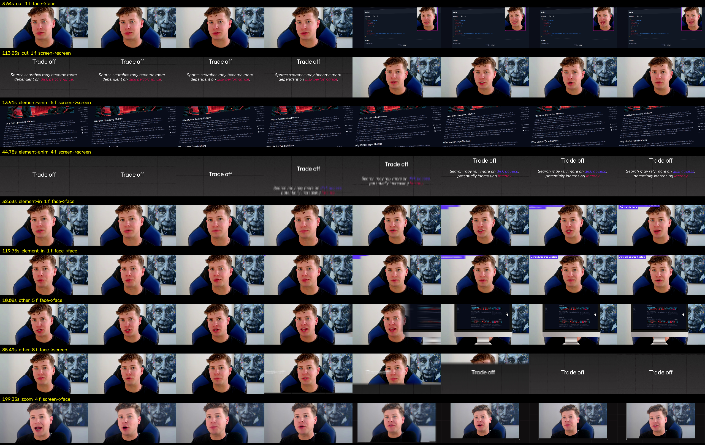

# Worked example: the Bulk Uploads video against the corpus

`audit_transitions.py` on "Bulk Uploads_FinalCleanUps.mp4" (3:27) with the camera audit for context.

## What the edit does

| | Bulk Uploads | corpus (50 videos) |
|---|---|---|
| shot changes per minute | 11.9 | 2.6 median, 20 max |
| cuts, share of shot changes | 29% | 65% |
| slides and pushes | 56% | 6% |
| dissolves | 0% | 4% |
| fades | 0% | 4% |
| animated moves (other) | 12% | 20% |
| element animations (labels, cards over a held shot) | 18 in 3.5 min | 62% of all visible changes |

Reading: the edit is built on card slide-ins. Almost every card arrives on a push and leaves on one, which
is the opposite weighting from the corpus, where the join is a cut and the push is the exception. Combined
with the camera audit (7 changes a minute, many 4 s face beats), the two together are what make it feel busy.

## What the rules would change

- Keep the push for cards arriving over the face (rule 2), one direction, 0.3 s. That is the part of the
  current style the corpus supports.
- Cards leave on a cut, not a reverse slide.
- Face to card and card to face joins where the card is already up: cut.
- Card to card inside a section: cut, or a 0.25 s dissolve when the content is the same kind.
- The "Trade off" title cards are chapter beats; a fade to black would be allowed there, but with four of
  them in three minutes a cut is the better choice.

## The test joins

Three joins from the video's own footage, each rendered as cut, push (0.27 s) and dissolve (0.25 s), with a
fade to black added on the card-to-card join. Play them back to back:

- `bulk-uploads-face_to_card.mp4`: face at 20 s to the Option 1 card at 40 s
- `bulk-uploads-card_to_face.mp4`: the card back to the face at 50 s
- `bulk-uploads-card_to_card.mp4`: Option 1 card to the trade-off card at 86 s

Rendered with `render_transitions.py`; the labels at the bottom name each variant.
