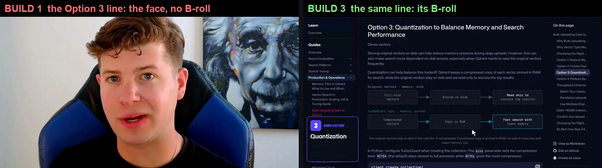

# Video builder

Ask for the video; get the video, reviewed. One command runs every skill of the suite in order, hands each the files the
previous ones made, and ends with the review, so nothing reaches a person unchecked.

## First, the questions

Before anything runs, the builder asks what only the presenter can answer:

1. The name for the name card.
2. The title under it.
3. Where the take is.
4. Whether there is a script, or one should be written and shown first.
5. The docs page.
6. The style.

If the script has no `[**Lower third:** NAME | TITLE | 5 s]` and no `--name` / `--role` is given, `build.py` prints these
questions and stops. The [brand consistency](../brand-consistency/) skill has the reasons.

**The script controls the video.** The lines, the B-roll, the camera calls, the transitions and the name card all live in
it. To change the video, change the script and re-run from the stage it touches.

## Run it

```bash
python scripts/build.py --take RAW_TAKE.mp4 --script SCRIPT.md --out BUILD_DIR --label "Topic, style"
```

The take is the presenter's raw recording, retakes and all. The script is the suite's three-layer script: the lines, the
`[B-ROLL: ...]` markers, the `[**Camera:** ...]` calls with their **Transition:** values, the name card, and a
`Source page:` note.

| stage | skill | what it makes |
|---|---|---|
| cut | [editing](../editing/) | the take cut to the script: last complete take of each line (said in other words is fine), eyes on the lens, voice locked to the lips, every cut point placed by the sound |
| words | | the cut's words at cut time |
| gaze | [editing](../editing/) | where the eyes leave the lens: where the face must be off screen |
| camera | [camera-layout](../camera-layout/) | the planner's camera plan, as a check on the script's own calls |
| keyterms | [broll-recorder](../broll-recorder/) | which lines earn B-roll by key term, against the script's markers |
| broll | [broll-recorder](../broll-recorder/) | every marker recorded: the docs page at 1.4x zoom, opening on its section |
| assets | [broll-recorder](../broll-recorder/) | the page's figures and code, captured sharp, with its Best fit / Watch for lines |
| style | editing-style, [brand consistency](../brand-consistency/) | the styled video ([listed sections](../../styles/listed-sections/) by default: it builds itself from the script and the page), with the code typed live and the Qdrant name card |
| master | editing-style | loudness to YouTube's level, picture untouched |
| review | [video-review](../video-review/) | the audit: every problem with its time and frame, every join heard in the raw take, the name card read off the screen |

Every stage keeps its outputs, so a fix re-runs only what it touches (`--from STAGE`, `--redo STAGE,...`). `BUILD.md` says what
each stage did and how long it took; the review's `report.md` says what is still wrong.

## The Bulk Uploads builds, and what the review made of them

Built from the raw Bulk Uploads take (9:37) and its script, four times. The review decided what happened next each time.

| build | what changed before it | the review found |
|---|---|---|
| 1 | first run, every skill as it was | **8 to fix**: 6 script lines the cut dropped (said in other words), the Option 3 B-roll missing because of one of them, and the full face where that B-roll should be; 36 to check |
| 2 | the cut finds lines said in other words; the style only places a line where the cut really says it | **0 to fix**, 25 to check |
| 3 | the recap on the wrap-up line, softened list thumbnails, the tick in the number's chip | **0 to fix**, 19 to check: the style's corner window where the script says FULL (6), the docs page's 23 px text against a 24 px bar (10), the script's Count section still timed for the old cut, the title over the chin, the list leading into a B-roll |
| 4 | a person heard a clipped word (the first 40 ms of "when" at 0:21.9), so the review got a join check (16 joins to fix on build 3's cut) and the cut places its cut points by the sound; the Qdrant name card; code typed live; the questions before building | **0 to fix**, 23 to check: the name card read on screen 0:06 to 0:10, every join clean but 5 where words run together (listen), the same layout and docs-text checks as build 3 |

Builds 1 to 3 were counted with the same version of the review; build 4's review also hears the joins and reads the name card.

The review's one-line fixes pointed at the stage to fix: the lost lines at the cut (a second pass now finds a line said in
other words, between the takes of its neighbours), the missing B-roll at the style (a line the cut lost had been placed at the
wrong moment, and its list card cut the B-roll to 0.05 s, leaving the face where the docs should be).



See [SKILL.md](SKILL.md) for the inputs, the stages and how to act on the review.
