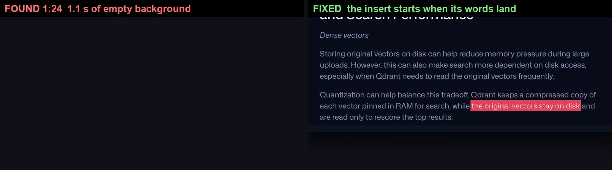
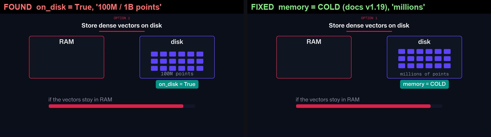
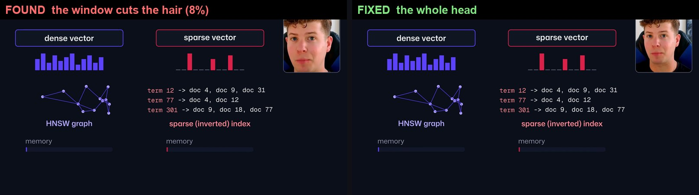
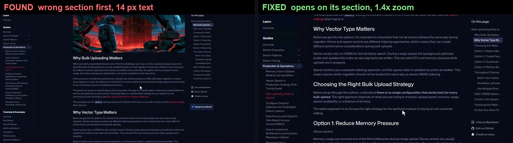
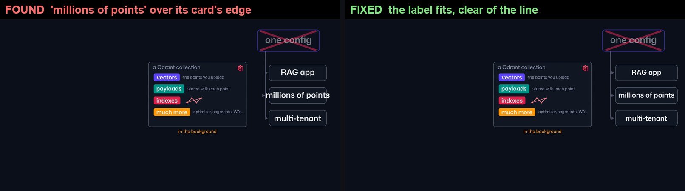
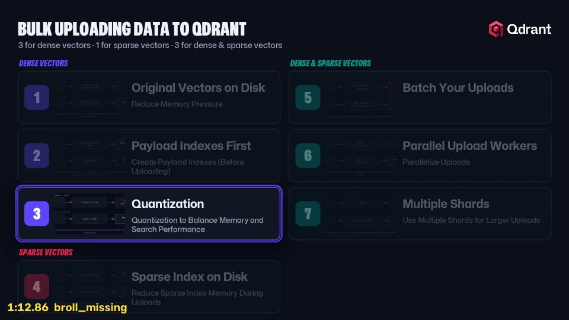
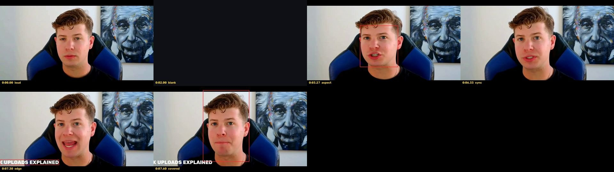

# Video review

The last step of the suite. It watches the finished video the way a careful viewer would, from the pixels and the sound
(not from the plan that made it), and reports every problem with its time, its frame number and a marked frame.

```bash
python scripts/review.py VIDEO.mp4 --out REVIEW --cut CUT.mp4 --script SCRIPT.md --words WORDS.json \
  --gaze GAZE.json --lookaways LOOKAWAYS.json --broll BROLL_DIR --cutlist CUTLIST.md --assets ASSETS.json
```

Only the video is required; every other input switches on the checks that need it. Out come `report.md` (findings by time,
each with its fix and the skill to fix it in), `sheet.jpg` (every finding's frame) and `report.json`.
**fix** = wrong, whatever the style. **check** = probably wrong, a person decides. **note** = worth knowing.

Every example below is a real finding on the Bulk Uploads video, in work that had already been called finished.

## What it checks

### Empty screens
An insert that starts before anything is drawn in it shows plain background. Checked on every frame.
The approved Code Report had five of these, the longest 1.1 s.



### What the docs actually say
API spellings the docs have moved on from, and numbers on screen that neither the script, the transcript nor the docs page
gives. A viewer reads a number on screen as a fact.



### The presenter
The face on screen while the eyes are off the lens; a stretched face; the head cut off by its window; the picture out of
step with the voice. The window is found by mapping the cut onto the output, and lip sync by aligning each nearby frame of
the cut to the face on its own (the frame really on screen matches to the pixel).



### B-roll
Missing, late against the first sound of its line, showing the wrong docs section (read off the frames every half
second, not taken from the recorder's manifest), or blended "ghost" frames.



### Text
Cut by the frame edge, spilling out of its card (a border running through the word), too small for a phone, misspelled
(OCR misreads are re-read at 2x before anything is called a typo).



### The script against the cut
Every line in the cut (said in other words is fine; missing is a fix), nothing said twice, no dead air, the camera calls
followed, the script's own Count section telling the truth.

In the first end-to-end build, the review flagged the six lines the cut had lost and the B-roll that went missing because
of them: the list took the B-roll's place at 1:12.86.



### Picture and sound
Black frames, long still holds ("more movement than not"), a whole side of the frame left empty, loudness against
YouTube's -14 LUFS, peaks and clipping.

## Proving it still works

`scripts/selftest.py CUT.mp4` plants four faults in ten seconds of a real cut: empty frames, a 10% stretch, the picture 3
frames behind the voice and a caption off the edge. It passes only if all four are caught where they were planted and
nothing else is reported as a fix. A check that stops firing looks exactly like a clean video, so run it after any change.



See [SKILL.md](SKILL.md) for how to read a report, the known limits of each check, and `references/rules.json` for
every threshold.
