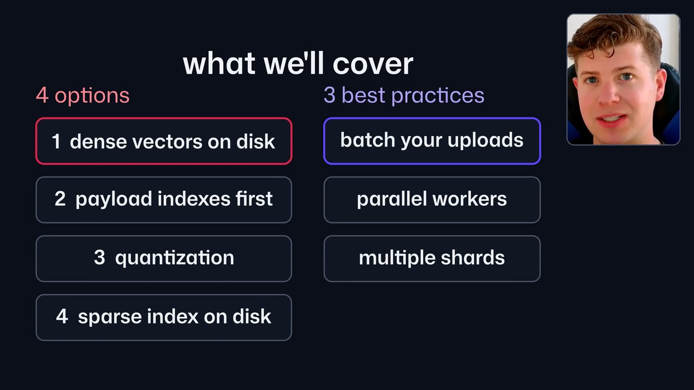

# Editing options

Finished editing styles for a presenter video. Each one takes the same clean cut and turns it into a
different finished video. All of them keep the suite's rules: the face is on screen only while the
presenter is looking at the lens, the voice is locked to the picture, and every render is checked
frame by frame.

| option | what it is | |
|---|---|---|
| [Animated Board](animated-board/) | one board per section that builds piece by piece on the words, with the face moving between half, card, full and corner layouts; five looks (brand, whiteboard, paper, neon, code editor) |  |
| [Code Report](code-report/) | copied from Fireship: real docs with a highlight synced to the voice, stock photos and memes with heavy captions, red title cards, a new visual every ~2 s |  |
