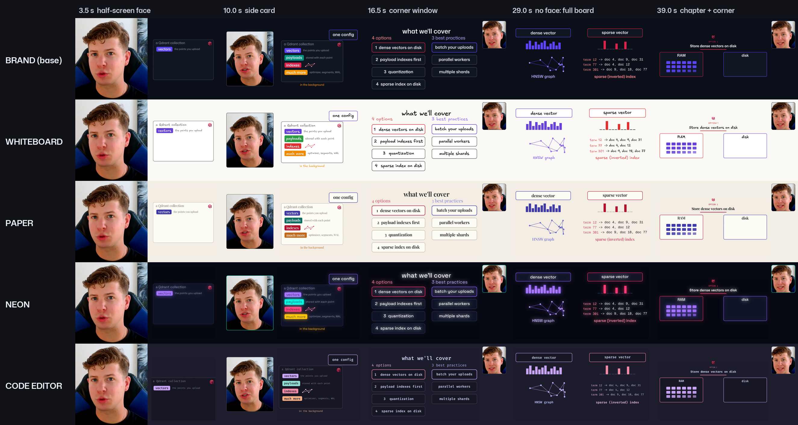
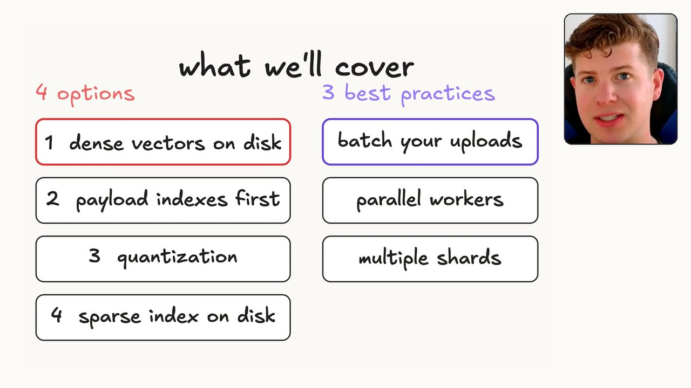
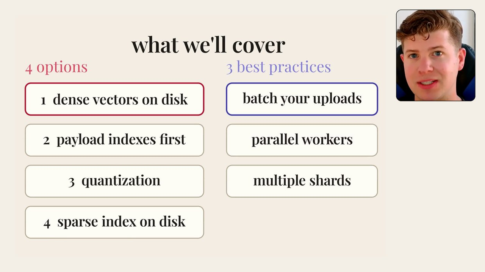
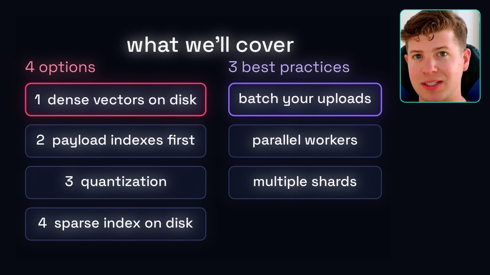
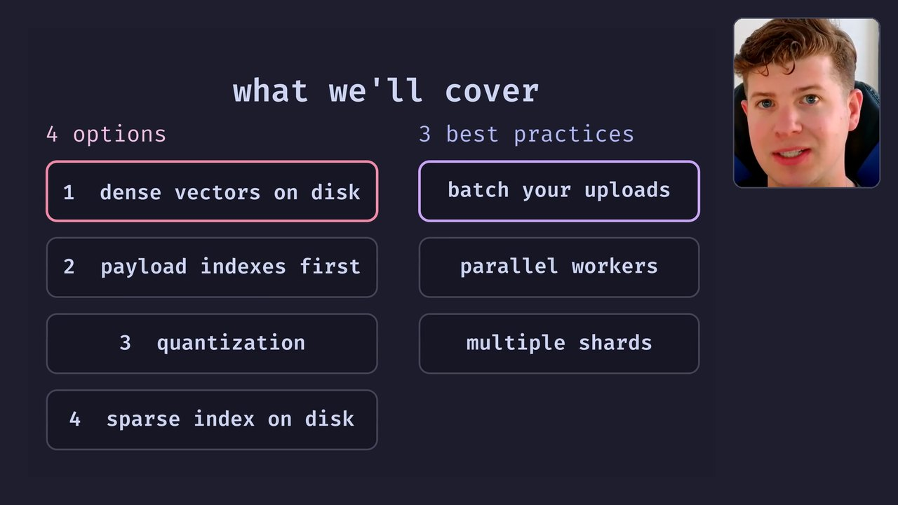

# Animated Board: one editing style, five looks

The Animated Board is the editing style chosen for Bulk Uploads. Each section of the video is explained on
one board that builds piece by piece as the presenter names each thing. The presenter's face moves between
a few layouts while he looks at the lens and leaves the screen whenever he looks away.

The style has **five looks**. They share the boards, the animation moves, the timing, the face direction
and the quality checks. Only the visual treatment changes: colors, fonts, the face-window border and one
optional effect. Pick a look the way you would pick a theme.



The grid shows the same five moments in every look: a half-screen face, the side card, a corner window, a
full board while the presenter looks away, and a chapter with a corner window. The layouts and the moves
are identical in every look; only the treatment changes.

## The looks

| look | treatment | frame |
|---|---|---|
| **Brand** (base) | Qdrant navy, Mona Sans and Geist Mono, red as the accent |  |
| **Whiteboard** | White paper, Excalifont hand lettering, Excalidraw marker colors |  |
| **Paper** | Warm cream with white cards, Playfair Display serif, deep print colors |  |
| **Neon** | Near-black, electric colors with a soft glow on the board, Space Grotesk |  |
| **Code editor** | A code editor's dark theme (Catppuccin Mocha), Fira Code throughout, syntax colors |  |

Watch the first 41 seconds of the four new looks side by side: [looks_side_by_side_0-41_720.mp4](looks_side_by_side_0-41_720.mp4)

## What every look shares

- **Boards.** Each section is explained on one board that builds one piece per spoken idea, about every
  two seconds. Each piece starts a fraction of a second before its word and settles in under a second.
  The timing comes from a measured audit of 30 windows of popular explainers.
- **Eye contact.** The face is on screen only while the presenter looks at the lens. Gaze is measured on
  the finished cut by clustering iris position and head turn, so reading a script beside the camera counts
  as looking away. Every look-away takes the face off screen, glances included.
- **Face layouts.** While the presenter is on the lens, the layout changes every few seconds: half screen,
  side card, full frame (for a few seconds where the board barely changes) and a corner window. The same
  layout never comes twice in a row. Every change is a 0.5 s move of the face window and the board together.
- **No dead space.** A camera keeps the board's content filling whatever space the face leaves. It pulls
  back just before a new piece lands and moves in slowly. Boards are rendered at 4K so enlarged boards
  stay sharp.
- **Checks.** A render ships only when `check_eyes` finds no face on screen while the eyes are off the
  lens, in any frame. `check_sync` must also find the voice and the face locked to the cut from start to
  end. The cut itself is joined frame-exactly, so sound and picture cannot drift.

## How a look is made

A look is one entry in `themes.py`: color and font overrides, a chip text color, an optional font scale
for wide fonts, a face-window border, and an optional effect such as the neon glow. The boards are
rendered once per look into their own folder, and the compositor picks up the look's background and border:

```
BOARD_THEME=paper python -m manim -qk --fps 30 --media_dir media_paper full_bulk.py Intro Opt1
BOARD_THEME=paper python style_full.py 0 41
```

The style and its tooling live in the local `editing-style` skill (`scripts/animkit`, `scripts/styles`).
This folder documents what the looks are and how they differ.
