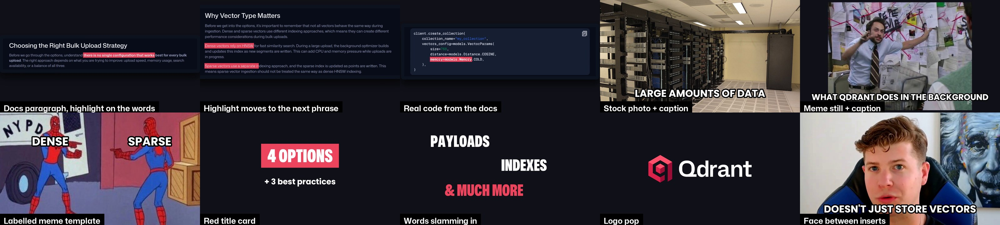
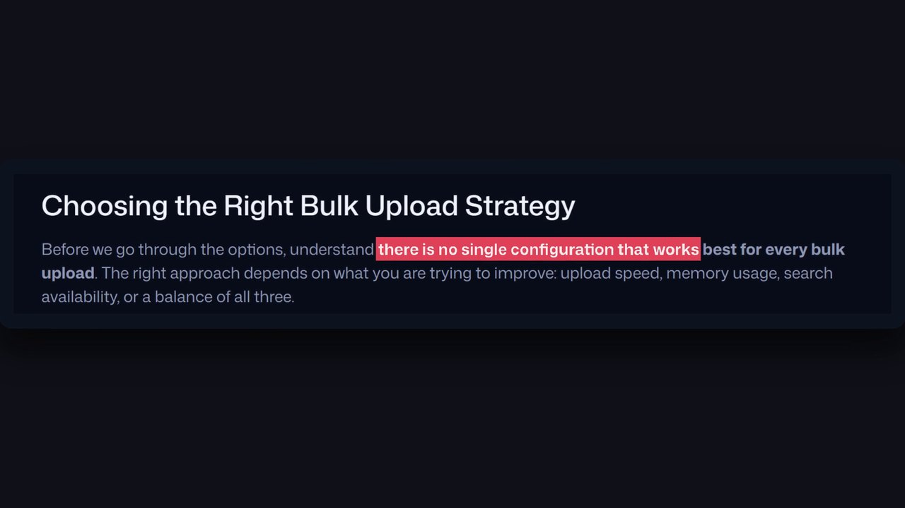
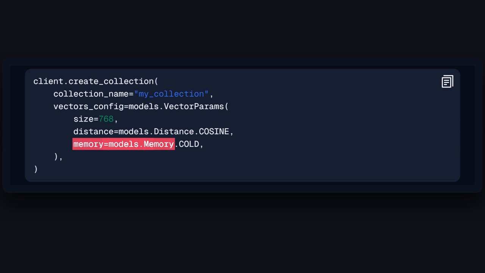
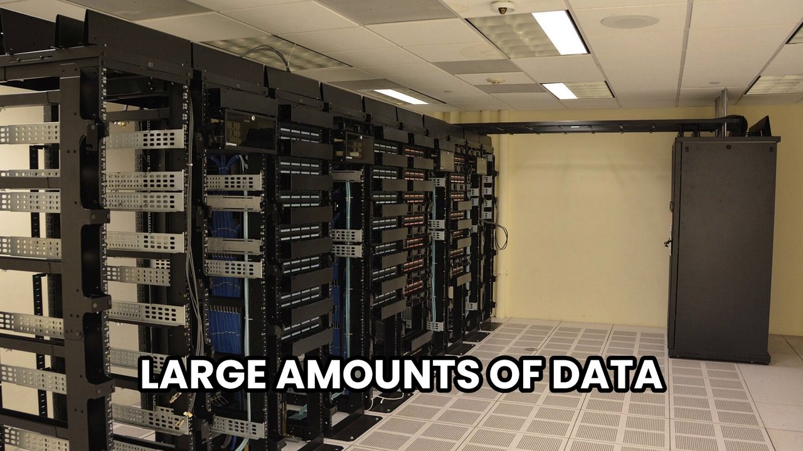
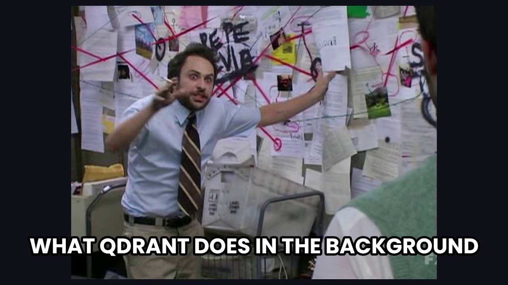
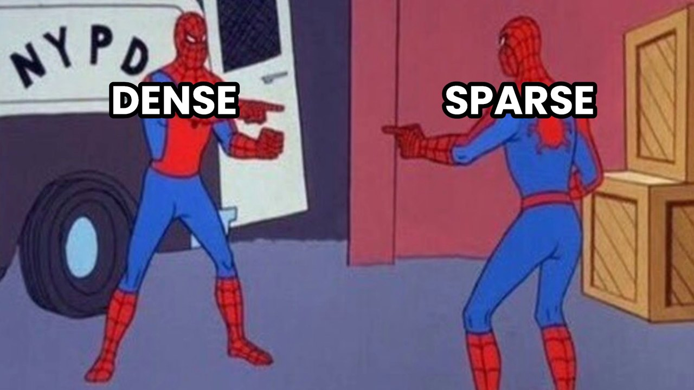
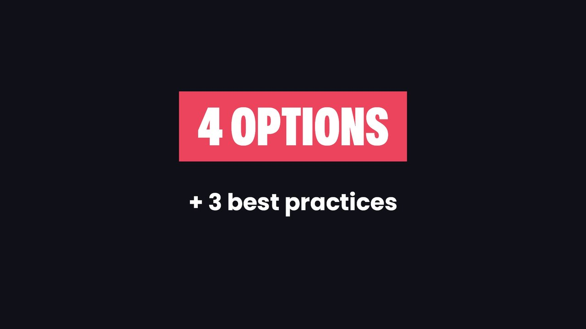
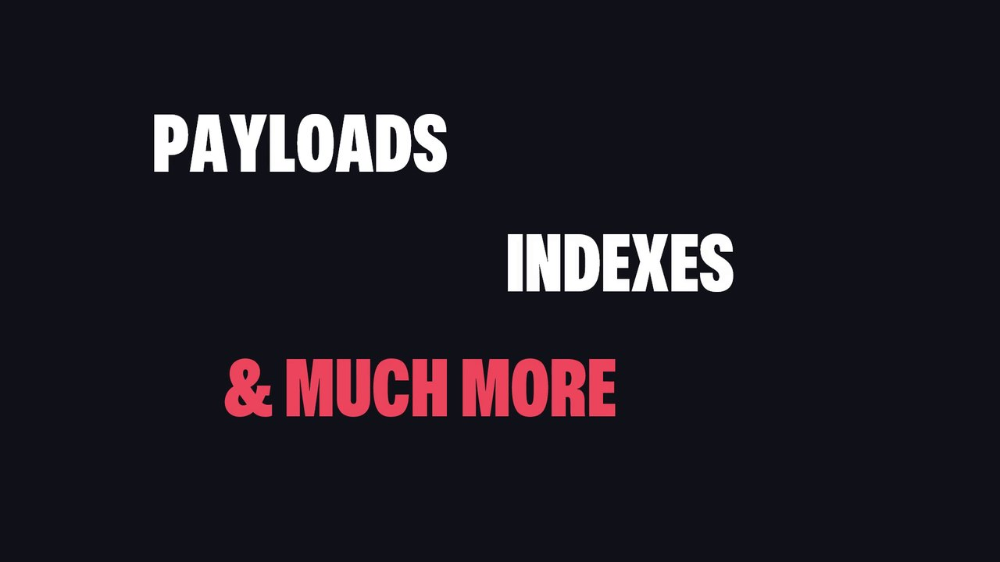
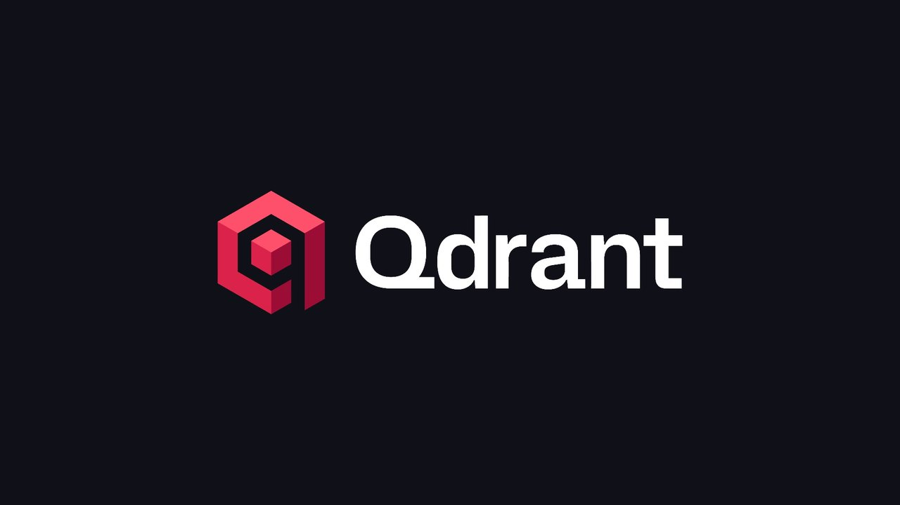
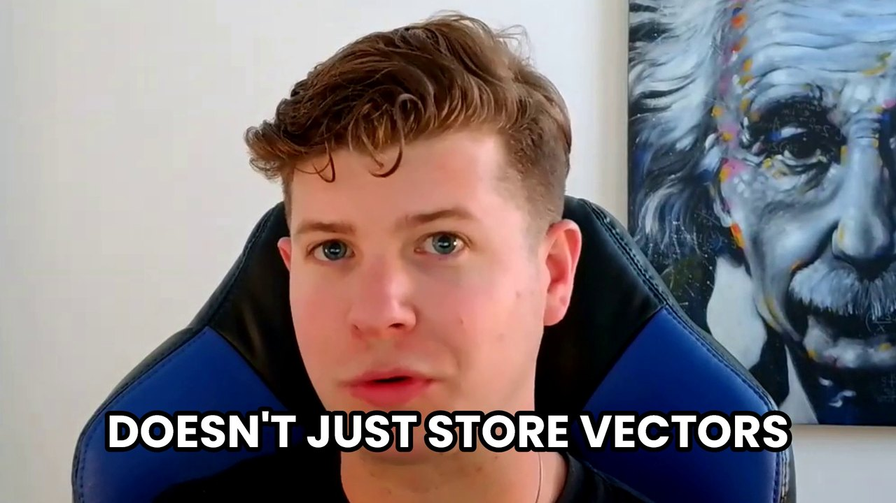

# Code Report: an editing option copied from Fireship

An editing style for a presenter video, copied from Fireship's Code Report format. The reference is
["The 'vibe coding' mind virus explained"](https://www.youtube.com/watch?v=Tw18-4U7mts) (2M views).

**The rule of the style: everything on screen is real, and it changes every ~2 seconds.** It uses real docs,
real code, real photos, real logos and well-known memes, never drawn diagrams or 3D. The cuts are hard, the
captions are heavy, and the docs highlight follows the voice word by word.



Watch the first 41 seconds of Bulk Uploads in this style: [code_report_0-41_720.mp4](code_report_0-41_720.mp4)

## How the reference was studied

YouTube blocks downloading the video itself, but two things can still be fetched. The storyboard is a
thumbnail every ~2 s across the whole video. The captions come with word timings. Lining them up shows
which visual answers which words, all the way through:

```
yt-dlp --js-runtimes node --extractor-args "youtube:player_client=web_safari" -f sb0 <url>
yt-dlp --js-runtimes node --skip-download --write-auto-subs --sub-format json3 <url>
```

145 storyboard frames over 4:46 showed a new visual in almost every frame, so roughly every 2 s. Use the same
two commands to study any other reference video.

## The devices

| device | in Fireship's video | in Bulk Uploads | frame |
|---|---|---|---|
| **Docs highlight** | a tweet; a red highlight sweeps across each phrase as he reads it | the real Qdrant bulk-upload docs paragraph, highlight synced to the presenter's words, the view pushing in |  |
| **Code highlight** | terminal and editor recordings | the real code from the docs, highlight on the line that matters (`memory=models.Memory.COLD`) |  |
| **Photo + caption** | stock footage with heavy white captions ("YO FAM BUY MY VIBE CODING COURSE") | a data center for "large amounts of data", RAM for "memory", a traffic jam for "performance" |  |
| **Meme + caption** | movie and TV stills with a caption ("SHUT HER DOWN") | "What Qdrant does in the background", One Does Not Simply, This Is Fine |  |
| **Labelled meme** | a template with labels on it | Spider-Man pointing at DENSE / SPARSE, each label landing on its word |  |
| **Red title card** | "RULE 1" in a red box, subtitle "choose the right stack" | "4 OPTIONS + 3 best practices", "OPTION 1 · dense vectors on disk" |  |
| **Word stack** | INGENUITY / CREATIVITY / INSTINCTS slamming in at staggered positions | PAYLOADS / INDEXES / & MUCH MORE |  |
| **Logo pop** | tool logos appearing as they are named | the Qdrant logo on "Qdrant" |  |
| **Face** | (Fireship never shows a face) | the presenter full frame between inserts, about a third of the time, alternating a slight punch-in, sometimes captioned |  |

Shared rules:
- **Background:** near-black (#111218) behind every card.
- **Captions:** Poppins Bold in capitals, white with a thick black outline, popping in.
- **Red:** #ED455D.
- **Cuts:** every cut is a hard cut.

## How the edit is written

The edit is a list of `(start time, kind, device)` keyed to the word times of the cut: a new entry roughly
every two seconds, each starting on the word it illustrates. To choose a device for a line:
1. If the line says something the docs say, use a docs highlight on that sentence.
2. If it names a thing (data, memory, a tool), use a photo or logo of it.
3. If it is a consequence, a trade-off or a joke, use a meme with a caption.
4. If it opens a section or a list, use a red title card or a word stack.
5. Otherwise, use the face.

Eye contact (a house rule): the face is shown only while the presenter is looking at the lens. During a
look-away, the insert before it holds. Every render is checked frame by frame: no face frames during
look-aways, and the voice locked to the cut. The sample passes both, with 0 face frames during look-aways
and 0 ms voice offset.

## Running it

- `scripts/capture_docs.py` opens the docs page with Playwright (Chrome) and screenshots the paragraphs at
  2x. It records where each phrase sits, so the highlight can follow the words. Edit `SHOTS` for a new
  page.
- `scripts/style_report.py` holds the devices and the edit list (`EDIT`) for Bulk Uploads. Write a new
  `EDIT` for a new video. It renders with the suite's shared editing engine (`engine.py`, kept in the local
  editing-style skill), which handles the cut, the gaze-based face rule, the sound and the checks.

```
python capture_docs.py
python style_report.py stills 2 10 21     # check frames first
python style_report.py 0 41               # render a range
python style_report.py                    # the whole video
```

## Credits and rights

The photos come from Wikimedia Commons:
- "Datacenter Server Racks", CC BY 2.0
- "168 pin and 184 pin DIMM", CC BY 4.0
- "Driving Cars in a Traffic Jam", CC BY 2.0

The CC BY licences need a credit line in the video description.

The meme stills are copyrighted frames, used the way creators commonly use them. Whether a Qdrant channel
runs them is a rights decision for the team. Each one can be swapped for a free-licence photo with the
same caption.

Docs screenshots are from qdrant.tech. The current docs use `memory=models.Memory.COLD` (Qdrant v1.19) for
what the script calls storing vectors on disk.
