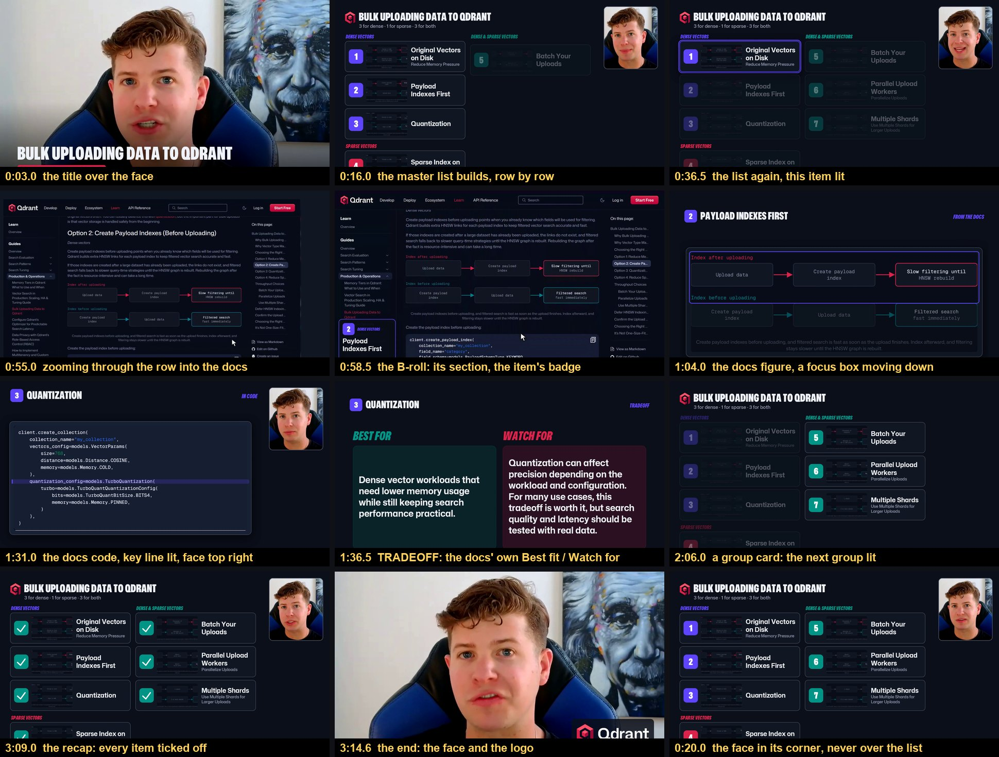
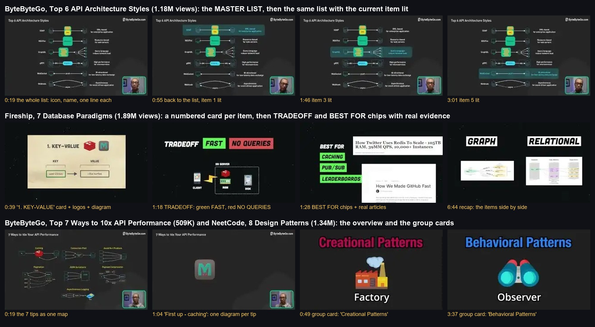

# Listed sections

The video as a numbered list, copied from the most-watched list videos on coding YouTube, and the one editing option that
builds itself: no edit list or boards drawn by hand. Give it the cut, the three-layer script and the docs page; the
[video builder](../../skills/video-builder/) runs it as the default style.

## Where it comes from

- **ByteByteGo** (Top 6 API Architecture Styles, 1.18M views): a master list of every item, shown whole, then again with the
  current item lit before each one; the presenter in a framed window that never covers the list.
- **Fireship** (7 Database Paradigms, 1.89M views): a numbered card per item, then the TRADEOFF in green and red chips.
- **NeetCode** (8 Design Patterns, 1.34M views): a group card when the list turns to a new kind of item.

## How it builds itself

- **The list** is the script's B-roll sections whose docs section has a "Best fit" line; the **groups** are the page's own
  tags ("Dense vectors", "Sparse vectors", "Dense & sparse vectors").
- **The pictures** are the page's own figures and code, captured at 2x so they stay sharp (`page_assets.py` in the
  [B-roll skill](../../skills/broll-recorder/)). **Every word on a chip** is the page's own: "Best fit" is BEST FOR, "Watch
  for" is WATCH FOR. Nothing on screen is invented.
- **Each line gets one beat**, in order:

  | line | on screen |
  |---|---|
  | the hook | the title over the face, then the list building row by row |
  | an item's announcement | the list, its row lit |
  | the item's B-roll line | a zoom through the lit row into the docs page, so the page lands on the line |
  | then | the docs figure (a focus box moving from its upper half to its lower half), the docs code with its key line lit |
  | the caveat line | the TRADEOFF card |
  | a group turn | the group card |
  | the wrap-up | the list, every item ticked off, then the logo |

- **The face** follows the suite's eye-contact rule (off whenever the eyes leave the lens). On the list and on code it sits
  in the free top-right corner and never shrinks the graphic (house rule: code keeps the presenter small, top right).
  Transitions are the script's own values: push in on a card, a white flash where a camera call says so.

## Script

`scripts/style_list.py CONFIG.json` (render), `CONFIG.json 0 60` (a range), `CONFIG.json stills 3 30 60` (a contact sheet).
The config comes from the video builder. It runs on the suite's shared rendering engine, which stays on the editing machine.
