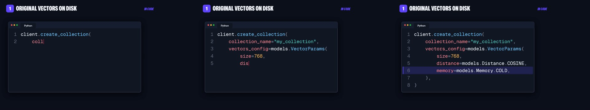

# Listed sections

The video as a numbered list, copied from the most-watched list videos on coding YouTube, and the one editing option that
builds itself: no edit list or boards drawn by hand. Give it the cut, the three-layer script and the docs page; the
[video builder](../../skills/video-builder/) runs it as the default style.

## Where it comes from

- **ByteByteGo** (Top 6 API Architecture Styles, 1.18M views): a master list of every item, shown whole, then again with the
  current item lit before each one; the presenter in a framed window that never covers the list.
- **Fireship** (7 Database Paradigms, 1.89M views): a numbered card per item, then the TRADEOFF in green and red chips.
- **NeetCode** (8 Design Patterns, 1.34M views): a group card when the list turns to a new kind of item.

## How it builds itself

- **The list** is the script's B-roll sections whose docs section has a "Best fit" line; the **groups** are the page's own
  tags ("Dense vectors", "Sparse vectors", "Dense & sparse vectors").
- **The pictures** are the page's own figures and code, captured at 2x so they stay sharp (`page_assets.py` in the
  [B-roll skill](../../skills/broll-recorder/)). **Every word on a chip** is the page's own: "Best fit" is BEST FOR, "Watch
  for" is WATCH FOR. Nothing on screen is invented.
- **Each part gets its beat**, in order:

  | part | on screen |
  |---|---|
  | the hook | the presenter's name card first, then the title over the face, then the list building row by row |
  | an item's announcement | the list, its row lit |
  | the item's B-roll line | a zoom through the lit row into the docs page, so the page lands on the line; the first time the page is shown, it opens on the page top and clicks into the section |
  | the rest of the item | **one card that stays up for the item's whole time**: the docs code typed out on the left, its key line lit, then the page's Best for and Watch for arriving beside it (Watch for on the caveat line). The docs figure comes first only when the item has time to spare |
  | a group turn | the group card |
  | the wrap-up | the list, every item ticked off, then the logo |

- **Every card can be read.** The first version changed card every 3 to 4 s (figure, code, tradeoff) and was judged too
  fast: "I can't actually sit there and look at it... it instantly is already gone". Items are now scheduled by reading
  time: code typed at 65 characters a second, then held; the tradeoff's words at 3.8 a second, its Watch for cut to whole
  sentences that fit. A card is never put up for less than it needs; what does not fit is left out.

  

- **The code is live**: the docs code types itself out in the brand's code card (Geist Mono, syntax colours in the
  brand palette, line numbers, the language tab), indentation arriving with each line as an editor puts it; then the
  line that matters is lit. The words typed are the page's own code, nothing else.

  

- **The name card** opens the video: the Qdrant lower third ([brand consistency](../../skills/brand-consistency/)) where
  the script's `[**Lower third:** NAME | TITLE | 5 s]` says (after the first line), then the title.
- **Where we are**: on every full-face stretch between the hook and the wrap-up, a small chip slides in at the top left,
  over the wall and clear of the face: the item's number and name and a dot per item (done ones filled).
- **The face** follows the suite's eye-contact rule (off whenever the eyes leave the lens). On the list and on code it sits
  in the free top-right corner and never shrinks the graphic (house rule: code keeps the presenter small, top right).
- **Transitions are soft and about 0.8 s**: a card fades in while it settles, the face dissolves back after a card, a white
  flash where the script asks for one. Face-to-face joins stay cuts. (Qdrant's review: the quick 0.5 s zoom-cuts were "how
  quick we are transitioning".)
- **Colours** all come from Qdrant's brand skill (brand-consistency's `brand.py`): groups in the brand's chart order,
  code in brand colours.

## Script

`scripts/style_list.py CONFIG.json` (render), `CONFIG.json 0 60` (a range), `CONFIG.json stills 3 30 60` (a contact sheet).
The config comes from the video builder. It runs on the suite's shared rendering engine, which stays on the editing machine.

## The style sheet

[`engine/style_list.json`](../../engine/style_list.json) sets how every Listed Sections video looks: the B-roll (the first
clip of a page clicks into it, 1.5 s before its line, then holds the section; the rest are 3 s), the presenter's window
(size, first-choice corner), the transitions (0.8 s, soft), the zoom (one small zoom-in held in the middle third) and the
reading pace of the cards. The build reads it; change a value there and the next build follows it.
